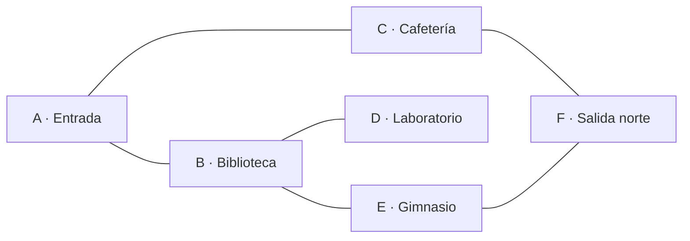
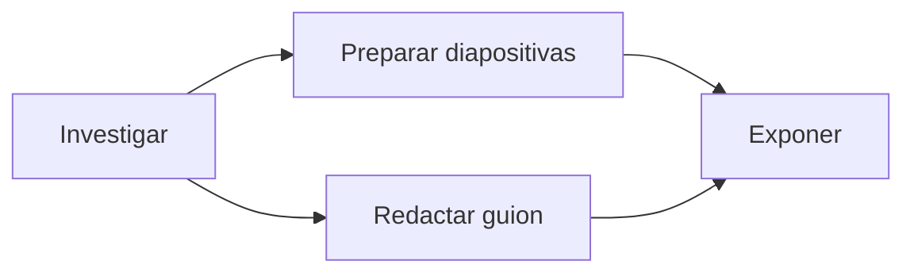
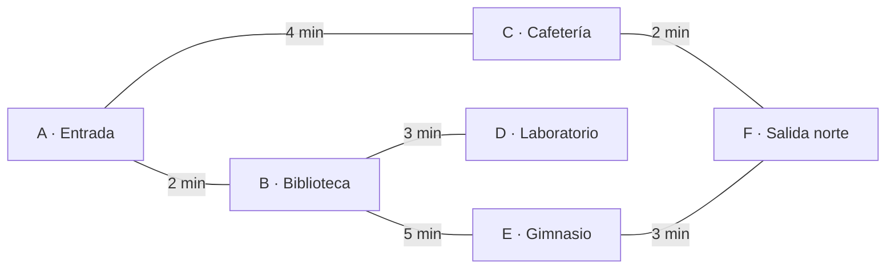
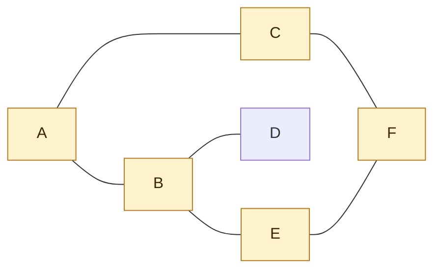
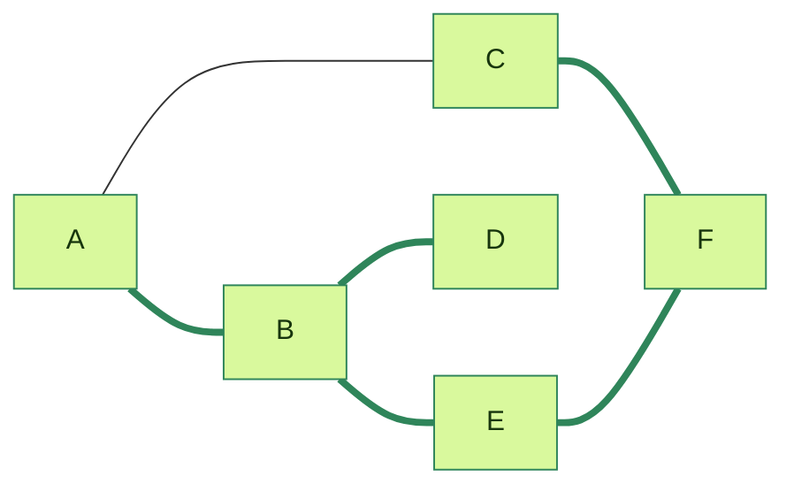
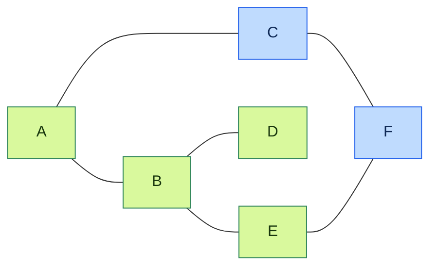

<!-- Colocar formato matemático -->
<script id="MathJax-script" async src="https://unpkg.com/mathjax@3/es5/tex-mml-chtml.js"></script>
<script>
  window.MathJax = {
    tex: {
      inlineMath: [["\\(", "\\)"]],
      displayMath: [["\\[", "\\]"]],
      processEscapes: true,
      processEnvironments: true
    },
    options: {
      ignoreHtmlClass: ".*|",
      processHtmlClass: "arithmatex"
    }
  };
</script>

# :material-graph-outline: Clase 9

Un árbol sirve para representar una jerarquía: cada nodo, salvo la raíz, tiene un único padre y existe un único camino para llegar a él.
Pero muchas relaciones no son jerarquías.
Entre los espacios de un colegio puede haber varias rutas, una persona puede tener muchas amistades y una página web puede enlazar a otras páginas que ya se habían visitado.

Esta clase presenta los **grafos**, estructuras que permiten representar esas conexiones.
También veremos dos formas de guardarlos en Python y el recorrido en profundidad, o DFS, que explora una ruta hasta donde pueda antes de retroceder.

## Grafos

Un **grafo** está formado por **vértices**, también llamados nodos, y **aristas**, las conexiones entre ellos.
A diferencia de un árbol, un nodo puede tener cualquier cantidad de vecinos, puede haber más de un camino entre dos nodos y pueden existir ciclos.

El siguiente grafo representa rutas entre seis espacios del colegio.

| Nodo | Espacio |
| ---- | ------- |
| A    | Entrada |
| B    | Biblioteca |
| C    | Cafetería |
| D    | Laboratorio |
| E    | Gimnasio |
| F    | Salida norte |



Cada línea es una arista.
Por ejemplo, B y E son vecinos porque hay una arista que los une.
El camino A, B, E, F, C llega de la entrada a la cafetería.
Además, A, B, E, F, C, A forma un **ciclo**: se puede regresar al nodo inicial sin repetir una arista.

!!! note "Un grafo no es un árbol"

    En un árbol se habla de raíz, padre, hijo e izquierdo o derecho.
    En este grafo esos términos no tienen sentido: A no es padre de B y C, y F se conecta con dos nodos sin pertenecer a una jerarquía.
    Aquí hablaremos de nodos, aristas y vecinos.

### Grafos no dirigidos

El grafo anterior es **no dirigido**.
Sus aristas no tienen flecha, así que una ruta puede recorrerse en ambos sentidos: si se puede ir de B a E, también se puede ir de E a B.

El **grado** de un nodo es la cantidad de vecinos que tiene.
B tiene grado 3 porque se conecta con A, D y E.
D tiene grado 1; solo se conecta con B.

Este tipo de grafo sirve para modelar relaciones simétricas, como calles de doble vía o amistades: si Ana es amiga de Bruno, Bruno también es amigo de Ana.

### Grafos dirigidos

En un **grafo dirigido**, cada arista tiene una dirección.
Una flecha de A hacia B permite ir de A a B, pero no garantiza que se pueda volver de B a A.

El siguiente ejemplo representa dependencias entre tareas.
Para exponer el proyecto primero deben estar listas la investigación y las diapositivas.



En este caso, Investigar tiene dos aristas que salen y ninguna que entra.
Exponer tiene dos aristas que entran y ninguna que sale.
La dirección es parte de la información del problema, no solo una diferencia de dibujo.

### Grafos ponderados

Una arista puede guardar un número llamado **peso**.
El peso representa una cantidad asociada a la conexión: distancia, tiempo, costo o capacidad.



El peso de la arista A--B es 2 minutos.
Un grafo puede ser dirigido y ponderado a la vez, por ejemplo si una calle tiene un sentido y un tiempo de recorrido.
DFS solo necesita saber qué nodos son vecinos; usaremos los pesos más adelante cuando busquemos rutas de menor costo.

## Representar un grafo en Python

El diagrama es útil para las personas, pero el programa necesita una representación que pueda recorrer.
Las dos más comunes son la lista de adyacencia y la matriz de adyacencia.

### Lista de adyacencia

Una **lista de adyacencia** guarda, para cada nodo, la lista de sus vecinos.
En Python, un diccionario permite asociar el nombre de cada nodo con esa lista.

```python
grafo = {
    "A": ["B", "C"],
    "B": ["A", "D", "E"],
    "C": ["A", "F"],
    "D": ["B"],
    "E": ["B", "F"],
    "F": ["C", "E"],
}

print(grafo["B"])   # (1)!
print(grafo["F"])   # (2)!
```

1. `['A', 'D', 'E']` – los tres vecinos de B.
2. `['C', 'E']` – las rutas que salen de F.

Como el grafo es no dirigido, cada arista aparece dos veces.
La conexión entre B y E está en la lista de B y también en la de E.
Omitir una de las dos convertiría el grafo, sin querer, en dirigido.

En un grafo ponderado, cada vecino se guarda junto con el peso de su arista.
Una tupla reúne esos dos valores.

```python
rutas_con_tiempo = {
    "A": [("B", 2), ("C", 4)],
    "B": [("A", 2), ("D", 3), ("E", 5)],
    "C": [("A", 4), ("F", 2)],
    "D": [("B", 3)],
    "E": [("B", 5), ("F", 3)],
    "F": [("C", 2), ("E", 3)],
}

for vecino, minutos in rutas_con_tiempo["A"]:
    print(f"A -> {vecino}: {minutos} min")
```

```
A -> B: 2 min
A -> C: 4 min
```

### Matriz de adyacencia

Una **matriz de adyacencia** es una tabla cuadrada.
Las filas indican el nodo de salida y las columnas, el nodo de llegada.
Antes de leerla se debe fijar el orden de los nodos.

Para el grafo de rutas usaremos el orden A, B, C, D, E, F.
Un `1` indica que existe una arista y un `0` que no existe.

| Desde \ Hasta | A | B | C | D | E | F |
| ------------- | - | - | - | - | - | - |
| A             | 0 | 1 | 1 | 0 | 0 | 0 |
| B             | 1 | 0 | 0 | 1 | 1 | 0 |
| C             | 1 | 0 | 0 | 0 | 0 | 1 |
| D             | 0 | 1 | 0 | 0 | 0 | 0 |
| E             | 0 | 1 | 0 | 0 | 0 | 1 |
| F             | 0 | 0 | 1 | 0 | 1 | 0 |

```python
nodos = ["A", "B", "C", "D", "E", "F"]
matriz = [
    [0, 1, 1, 0, 0, 0],
    [1, 0, 0, 1, 1, 0],
    [1, 0, 0, 0, 0, 1],
    [0, 1, 0, 0, 0, 0],
    [0, 1, 0, 0, 0, 1],
    [0, 0, 1, 0, 1, 0],
]

fila_a = nodos.index("A")
columna_e = nodos.index("E")

print(matriz[fila_a][columna_e])   # (1)!
```

1. `0` – no existe una arista directa entre A y E.

La diagonal contiene ceros porque ningún nodo tiene una arista hacia sí mismo.
Además, la matriz es simétrica: el valor de la fila B, columna E coincide con el de la fila E, columna B.
Eso ocurre porque el grafo es no dirigido.
En un grafo dirigido, esas dos posiciones pueden ser distintas.

| Aspecto | Lista de adyacencia | Matriz de adyacencia |
| ------- | ------------------- | -------------------- |
| Guarda | Solo los vecinos que existen | Una posición para cada par de nodos |
| Consultar si A conecta con E | Hay que buscar E entre los vecinos de A | Se consulta directamente una celda |
| Recorrer los vecinos de A | Recorre solo sus vecinos | Revisa toda la fila |
| Conviene cuando | El grafo tiene pocas aristas respecto a sus nodos | El grafo es denso o se consultan conexiones directas constantemente |

En este curso, la lista de adyacencia será la representación principal.
Es más compacta para la mayoría de grafos reales y permite recorrer los vecinos directamente.

## Recorrido en profundidad

Un recorrido **DFS** (*depth-first search*, búsqueda en profundidad) parte de un nodo y visita un vecino; desde ese vecino sigue avanzando mientras encuentre uno nuevo.
Cuando ya no puede avanzar, retrocede al último punto donde quedó otro camino pendiente.

Si aplicáramos la idea de recorrer árboles al grafo sin ninguna precaución, aparecería un problema.
Desde A se puede llegar a B, desde B volver a A y repetir el recorrido para siempre.
Por eso DFS mantiene un conjunto de nodos **visitados**.



!!! danger "Marcar antes de seguir"

    Un nodo debe marcarse como visitado antes de explorar a sus vecinos.
    Si se marca después, A puede llamar a B y B puede volver a llamar a A antes de que A figure como visitado.
    El ciclo nunca termina.

Para que el resultado sea predecible, mantendremos el orden de vecinos escrito en el diccionario.
Desde A, el recorrido visitará primero B antes que C.
Con ese orden, DFS desde A debe producir `A, B, D, E, F, C`.

### DFS recursivo

La versión recursiva se parece al preorden de un árbol: procesa el nodo actual y llama a la misma función para cada vecino que todavía no ha sido visitado.
La diferencia es el conjunto `visitados`, que reemplaza la idea de no volver al padre.

```python
def dfs_recursivo(grafo, inicio):
    recorrido = []
    visitados = set()

    def explorar(nodo):
        visitados.add(nodo)          # (1)!
        recorrido.append(nodo)

        for vecino in grafo[nodo]:
            if vecino not in visitados:
                explorar(vecino)     # (2)!

    explorar(inicio)
    return recorrido


print(dfs_recursivo(grafo, "A"))
```

1. El nodo se marca antes de mirar sus vecinos, para no entrar otra vez a través de un ciclo.
2. La llamada recursiva baja por el primer vecino no visitado. Cuando termina, el `for` continúa con el siguiente vecino pendiente.

```
['A', 'B', 'D', 'E', 'F', 'C']
```

El siguiente diagrama resume el camino de descubrimiento.
Las aristas gruesas forman la ruta por la que DFS llegó a cada nodo nuevo; las otras conexiones se descartan porque llevan a nodos ya visitados.



La tabla sigue las llamadas que descubren un nodo.
La pila se escribe de la llamada más antigua a la más reciente, de izquierda a derecha.
Las vueltas desde D y C no necesitan una nueva llamada: simplemente terminan y permiten continuar donde se había quedado el `for`.

| Entra a | Pila de llamadas | `visitados` después de marcar | Vecinos descartados | Siguiente llamada | Recorrido |
| ------- | ---------------- | ----------------------------- | ------------------- | ----------------- | --------- |
| A | `explorar(A)` | A | — | B | A |
| B | `explorar(A)`, `explorar(B)` | A, B | A | D | A, B |
| D | `explorar(A)`, `explorar(B)`, `explorar(D)` | A, B, D | B | termina y vuelve a B | A, B, D |
| E | `explorar(A)`, `explorar(B)`, `explorar(E)` | A, B, D, E | B | F | A, B, D, E |
| F | `explorar(A)`, `explorar(B)`, `explorar(E)`, `explorar(F)` | A, B, D, E, F | E | C | A, B, D, E, F |
| C | `explorar(A)`, `explorar(B)`, `explorar(E)`, `explorar(F)`, `explorar(C)` | A, B, C, D, E, F | A, F | termina | A, B, D, E, F, C |

Después de C, la función retorna sucesivamente a F, E, B y A.
En cada uno, todos los vecinos restantes ya están en `visitados`, así que el recorrido termina.

### DFS iterativo

La recursión guarda las llamadas pendientes en la pila de llamadas de Python.
La versión iterativa administra esa pila de manera explícita con una lista.

Esta versión marca un nodo cuando lo extrae de la pila, justo antes de procesarlo.
Un nodo puede quedar pendiente más de una vez si se descubre por caminos distintos, pero la segunda vez se descarta de inmediato.
Esta decisión permite conservar exactamente el mismo orden que la versión recursiva.

```python
def dfs_iterativo(grafo, inicio):
    pila = [inicio]
    visitados = set()
    recorrido = []

    while pila:
        nodo = pila.pop()                # (1)!
        if nodo in visitados:
            continue

        visitados.add(nodo)              # (2)!
        recorrido.append(nodo)

        for vecino in reversed(grafo[nodo]):
            if vecino not in visitados:
                pila.append(vecino)

    return recorrido


print(dfs_iterativo(grafo, "A"))
```

1. `pop()` retira el último nodo que entró: la pila sigue la regla LIFO.
2. El conjunto se actualiza apenas el nodo sale de la pila. Si ese nodo ya había salido antes, `continue` lo descarta sin procesarlo una segunda vez.

```
['A', 'B', 'D', 'E', 'F', 'C']
```

La lista de vecinos de A es B, C.
Para que B salga primero, C debe entrar antes que B.
Por eso el `for` usa `reversed()`: apila los vecinos en orden inverso al orden en que se quieren visitar.

El diagrama muestra el estado justo después de procesar E.
A, B, D y E ya salieron de la pila; F será el siguiente nodo y C aún espera debajo de él.



La pila se escribe con el tope a la derecha.
Observe que C entra al procesar A, pero se mantiene pendiente mientras el algoritmo profundiza por B.
Más adelante F vuelve a dejar C pendiente; el segundo C se descarta cuando llega al tope.

| Nodo extraído | Pila antes de extraer | Vecinos que entran a la pila | Pila resultante | `visitados` | Recorrido |
| ------------- | --------------------- | ---------------------------- | --------------- | ------------ | --------- |
| A | A | C, B | C, B | A | A |
| B | C, B | E, D | C, E, D | A, B | A, B |
| D | C, E, D | ninguno | C, E | A, B, D | A, B, D |
| E | C, E | F | C, F | A, B, D, E | A, B, D, E |
| F | C, F | C | C, C | A, B, D, E, F | A, B, D, E, F |
| C | C, C | ninguno | C | A, B, C, D, E, F | A, B, D, E, F, C |
| C repetido | C | ninguno; se descarta | vacía | A, B, C, D, E, F | A, B, D, E, F, C |

F deja un segundo C en la pila porque C aún no se había visitado; solo estaba pendiente.
Cuando ese segundo C sale, ya pertenece a `visitados` y `continue` lo descarta.
Así se evita procesar C dos veces sin cambiar el orden del recorrido.

### Recursión o pila

| Versión | Qué guarda los nodos pendientes | Ventaja | Consideración |
| ------- | ------------------------------- | ------- | ------------- |
| Recursiva | La pila de llamadas de Python | Es corta y sigue naturalmente la definición de DFS | Un grafo muy profundo puede superar el límite de recursión |
| Iterativa | Una lista creada por el programa | Controla explícitamente la pila y evita ese límite | Requiere decidir cuidadosamente cuándo apilar y marcar |

Con una lista de adyacencia, ambas versiones visitan cada nodo alcanzable una vez y revisan cada arista cuando exploran sus vecinos.
Por eso su tiempo de ejecución es $O(V + E)$, donde $V$ es la cantidad de nodos y $E$ la cantidad de aristas.

!!! note "El inicio determina qué parte se recorre"

    DFS desde A visita los seis nodos porque todos se pueden alcanzar desde A.
    Si hubiera un séptimo nodo aislado, no aparecería en el resultado.
    Recorrer todas las componentes de un grafo requiere iniciar otro DFS desde cada nodo que todavía no se haya visitado; ese será un tema posterior.

## Ejercicios prácticos

### Leer un grafo

=== "Enunciado"
    Considere este grafo.

    ```mermaid
    flowchart LR
        P[P] --- Q[Q]
        P --- R[R]
        Q --- R
        R --- S[S]
    ```

    1. Indique si es dirigido o no dirigido.
    2. Escriba los vecinos de R y el grado de R.
    3. Escriba un ciclo del grafo.
    4. Escriba un camino de Q a S.

=== "Solución"
    El grafo es no dirigido porque sus aristas no tienen flecha.
    Los vecinos de R son P, Q y S, así que su grado es 3.

    Un ciclo es P, Q, R, P.
    Un camino de Q a S es Q, R, S.

### Completar representaciones

=== "Enunciado"
    El siguiente diccionario representa un grafo no dirigido.
    Complete las dos listas que faltan.

    ```python
    clubes = {
        "Arte": ["Música", "Robótica"],
        "Música": ["Arte", "Teatro"],
        "Robótica": ["Arte", "???"],
        "Teatro": ["Música", "???"],
    }
    ```

    Existe una arista entre Robótica y Teatro.
    Después, escriba la fila de Robótica en una matriz de adyacencia cuyo orden sea Arte, Música, Robótica, Teatro.

=== "Solución"
    Como el grafo no es dirigido, la arista debe aparecer en ambas listas.

    ```python
    clubes = {
        "Arte": ["Música", "Robótica"],
        "Música": ["Arte", "Teatro"],
        "Robótica": ["Arte", "Teatro"],
        "Teatro": ["Música", "Robótica"],
    }
    ```

    La fila de Robótica es `[1, 0, 0, 1]`: se conecta con Arte y Teatro, no consigo misma ni con Música.

### Simular DFS

=== "Enunciado"
    Use este orden de vecinos y no ejecute código al principio.

    ```python
    grafo_pequeno = {
        "A": ["B", "C"],
        "B": ["A", "D"],
        "C": ["A", "D"],
        "D": ["B", "C"],
    }
    ```

    1. Escriba el recorrido de `dfs_recursivo(grafo_pequeno, "A")`.
    2. Dibuje la pila de la versión iterativa justo después de procesar A y justo después de procesar B.
    3. Explique por qué D no vuelve a visitar B.

=== "Solución"
    El recorrido es A, B, D, C.
    Después de A, la pila es C, B, con B en el tope.
    Después de B, la pila es C, D.

    D no vuelve a visitar B porque B ya aparece en el conjunto de nodos visitados.
    La arista existe, pero DFS no vuelve a procesar un nodo que ya visitó.

### Corregir el ciclo

=== "Enunciado"
    Esta función nunca termina con un grafo que contenga el ciclo A--B--A.

    ```python
    def dfs_incompleto(grafo, nodo):
        print(nodo)
        for vecino in grafo[nodo]:
            dfs_incompleto(grafo, vecino)
    ```

    Modifíquela para que reciba y use un conjunto `visitados`.
    El recorrido debe detenerse al encontrar un nodo ya visto.

=== "Solución"
    ```python
    def dfs_corregido(grafo, nodo, visitados=None):
        if visitados is None:
            visitados = set()
        if nodo in visitados:
            return

        visitados.add(nodo)
        print(nodo)

        for vecino in grafo[nodo]:
            dfs_corregido(grafo, vecino, visitados)
    ```

    La comprobación al inicio también funciona, pero la idea indispensable es la misma: antes de explorar otra vez un nodo, se verifica si ya se había descubierto.

## Ejercicio integrador — Explorador del colegio

El mapa de un colegio se guarda como un grafo no dirigido.
El programa permite elegir un punto de inicio y recorre todos los espacios alcanzables con DFS recursivo e iterativo.

**Requisitos:**

1. Use la lista de adyacencia de las rutas A a F de esta clase.
2. Solicite un nodo inicial y rechace uno que no exista.
3. Implemente `dfs_recursivo` y `dfs_iterativo`; ambas funciones deben retornar una lista.
4. Muestre ambos recorridos con flechas entre los nodos.
5. Compruebe que los dos resultados son iguales para el orden de vecinos definido.

### Solución

#### Programa completo

```python
def dfs_recursivo(grafo, inicio):
    recorrido = []
    visitados = set()

    def explorar(nodo):
        visitados.add(nodo)
        recorrido.append(nodo)

        for vecino in grafo[nodo]:
            if vecino not in visitados:
                explorar(vecino)

    explorar(inicio)
    return recorrido


def dfs_iterativo(grafo, inicio):
    pila = [inicio]
    visitados = set()
    recorrido = []

    while pila:
        nodo = pila.pop()
        if nodo in visitados:
            continue

        visitados.add(nodo)
        recorrido.append(nodo)

        for vecino in reversed(grafo[nodo]):
            if vecino not in visitados:
                pila.append(vecino)

    return recorrido


colegio = {
    "A": ["B", "C"],
    "B": ["A", "D", "E"],
    "C": ["A", "F"],
    "D": ["B"],
    "E": ["B", "F"],
    "F": ["C", "E"],
}

inicio = input("Punto de inicio (A-F): ").upper()

if inicio not in colegio:
    print("Ese punto no existe en el mapa.")
else:
    recursivo = dfs_recursivo(colegio, inicio)
    iterativo = dfs_iterativo(colegio, inicio)

    print("DFS recursivo:", " -> ".join(recursivo))
    print("DFS iterativo:", " -> ".join(iterativo))
    print("¿Coinciden?", recursivo == iterativo)
```

!!! example "Casos de ejecución"

    === "Inicio en A"
        ```
        Punto de inicio (A-F): a
        DFS recursivo: A -> B -> D -> E -> F -> C
        DFS iterativo: A -> B -> D -> E -> F -> C
        ¿Coinciden? True
        ```

    === "Nodo inválido"
        ```
        Punto de inicio (A-F): Z
        Ese punto no existe en el mapa.
        ```
