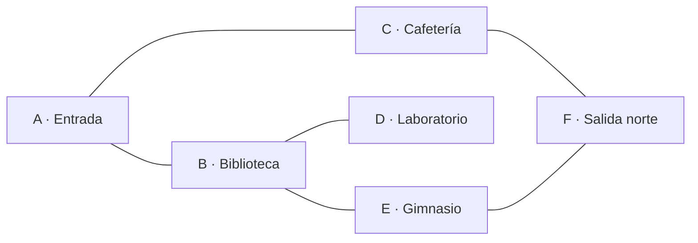
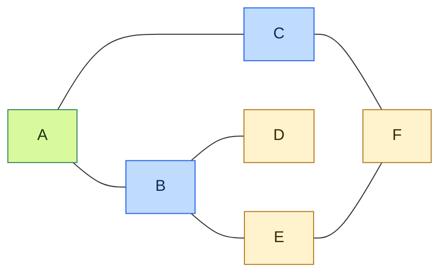
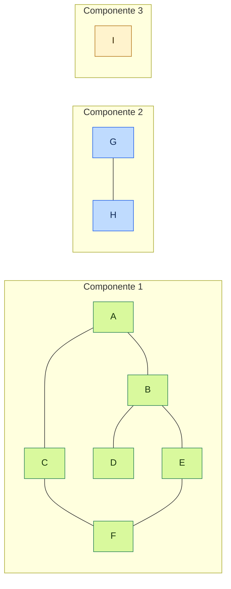
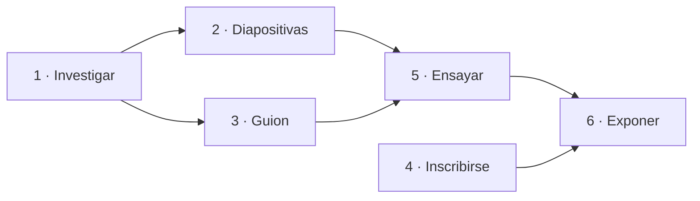
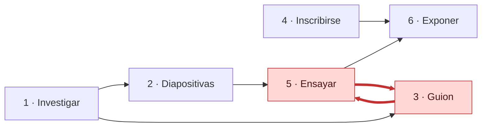
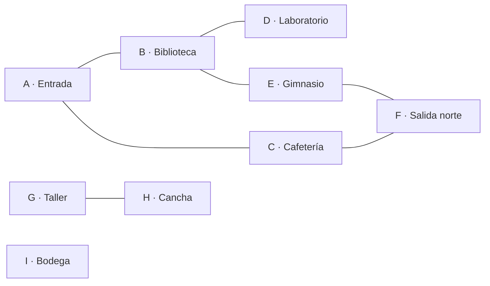

<!-- Colocar formato matemático -->
<script id="MathJax-script" async src="https://unpkg.com/mathjax@3/es5/tex-mml-chtml.js"></script>
<script>
  window.MathJax = {
    tex: {
      inlineMath: [["\\(", "\\)"]],
      displayMath: [["\\[", "\\]"]],
      processEscapes: true,
      processEnvironments: true
    },
    options: {
      ignoreHtmlClass: ".*|",
      processHtmlClass: "arithmatex"
    }
  };
</script>

# :material-graph: Clase 10

El recorrido en profundidad de la clase anterior explora una ruta hasta el fondo y sirve para saber qué nodos se pueden alcanzar.
Sin embargo, no indica cuál es la ruta con menos pasillos entre dos espacios, cuántos grupos separados hay en un mapa ni en qué orden se deben hacer tareas que dependen unas de otras.

## Recorrido en anchura

Un recorrido **BFS** (*breadth-first search*, búsqueda en anchura) visita primero todos los vecinos del nodo inicial, después los vecinos de esos vecinos, y así sucesivamente, de modo que avanza por niveles.
Para ver por qué esto importa, sirve retomar el mapa del colegio, que se muestra a continuación.



Un DFS desde A, que visita los vecinos en el orden en que aparecen, recorre A, B, D, E, F, C y llega a F por el camino A, B, E, F, que usa $3$ pasillos.
Sin embargo, el camino A, C, F llega al mismo lugar con solo $2$ pasillos, ya que DFS no garantiza el camino más corto: se compromete con el primer vecino que encuentra y lo sigue hasta el fondo.

La **distancia** entre dos nodos es la cantidad mínima de aristas que hay que recorrer para ir de uno al otro.
BFS evita el problema anterior porque nunca visita un nodo a distancia $k + 1$ antes de haber visitado todos los nodos a distancia $k$.

### La cola

Para respetar el orden por niveles, el primer nodo descubierto debe ser el primero en atenderse, regla que se llama **FIFO** (*first in, first out*, el primero en entrar es el primero en salir) y que cumple una **cola**.
La pila de DFS, en cambio, seguía la regla contraria: el último en entrar era el primero en salir.
En esta clase, la pila se escribe con el tope a la derecha y la cola con el frente a la izquierda.

Python ofrece `deque`, del módulo `collections`, que permite agregar y retirar elementos de ambos extremos de forma eficiente.

```python
from collections import deque

cola = deque(["B", "C"])
cola.append("D")             # (1)!
print(cola.popleft())        # (2)!
print(cola)
```

1. `append` agrega al final de la cola, que es por donde entran los nodos nuevos.
2. `popleft` retira el primer elemento de la cola, que es el que lleva más tiempo esperando.

```
B
deque(['C', 'D'])
```

!!! warning "No usar una lista como cola"

    Una lista también permite sacar el primer elemento con `pop(0)`, pero Python desplaza todos los elementos restantes una posición al hacerlo.
    Por eso, en un grafo grande, ese costo extra hace lento el recorrido, mientras que con `deque` sacar por el frente no mueve los demás elementos.

### BFS iterativo

BFS necesita saber qué nodos ya fueron descubiertos y a qué distancia está cada uno, y un solo diccionario cumple ambas tareas: sus llaves son los nodos descubiertos y sus valores son las distancias.
Además, un nodo que no aparece en el diccionario todavía no se ha visto.

El algoritmo asigna primero la distancia $0$ al nodo inicial y lo coloca en la cola.
Después, mientras la cola tenga nodos, saca el primero y, a cada vecino que todavía no tiene distancia, le asigna la distancia del nodo actual más $1$ y lo agrega a la cola.

El mapa anterior se guarda como una lista de adyacencia, con el orden de vecinos del diagrama, y el siguiente programa calcula las distancias desde A.

```python
from collections import deque

grafo = {
    "A": ["B", "C"],
    "B": ["A", "D", "E"],
    "C": ["A", "F"],
    "D": ["B"],
    "E": ["B", "F"],
    "F": ["C", "E"],
}


def bfs(grafo, inicio):
    distancia = {inicio: 0}                          # (1)!
    cola = deque([inicio])

    while cola:
        nodo = cola.popleft()                        # (2)!
        for vecino in grafo[nodo]:
            if vecino not in distancia:              # (3)!
                distancia[vecino] = distancia[nodo] + 1
                cola.append(vecino)                  # (4)!

    return distancia


print(bfs(grafo, "A"))
```

1. El nodo inicial está a $0$ aristas de sí mismo, y el diccionario hace de registro de nodos visitados y de distancias al mismo tiempo.
2. `popleft` retira el nodo que lleva más tiempo esperando, así los niveles se atienden en orden.
3. Un vecino que ya aparece en el diccionario fue descubierto antes, así que no se vuelve a agregar.
4. El vecino se marca y entra a la cola en el mismo momento, antes de salir de ella.

```
{'A': 0, 'B': 1, 'C': 1, 'D': 2, 'E': 2, 'F': 2}
```

Las llaves del diccionario quedan en el orden en que BFS descubrió los nodos, que es A, B, C, D, E, F, y las distancias confirman que F está a solo $2$ pasillos de A.
Además, cada nodo entra a la cola una sola vez y cada arista se revisa una vez desde cada extremo, por lo que, con una lista de adyacencia, el tiempo de ejecución de BFS es $O(V + E)$, igual que el de DFS.

### Seguimiento paso a paso

BFS procesa los nodos por niveles: A está en el nivel $0$, B y C en el nivel $1$, y D, E y F en el nivel $2$, de modo que los dos nodos del nivel $1$ salen de la cola antes que cualquiera del nivel $2$.
La tabla muestra, para cada paso, el estado de la cola, que se escribe con el frente a la izquierda, además de las distancias asignadas, donde un guion indica que el nodo todavía no tiene distancia.



| Paso | Sale de la cola | Entran a la cola | Cola después | Distancias de A, B, C, D, E, F |
| ---- | --------------- | ---------------- | ------------ | ------------------------------ |
| 0 | — | A | A | 0, -, -, -, -, - |
| 1 | A | B, C | B, C | 0, 1, 1, -, -, - |
| 2 | B | D, E | C, D, E | 0, 1, 1, 2, 2, - |
| 3 | C | F | D, E, F | 0, 1, 1, 2, 2, 2 |
| 4 | D | ninguno | E, F | 0, 1, 1, 2, 2, 2 |
| 5 | E | ninguno | F | 0, 1, 1, 2, 2, 2 |
| 6 | F | ninguno | vacía | 0, 1, 1, 2, 2, 2 |

En el paso $2$, A es vecino de B pero ya tiene distancia, por lo que no vuelve a entrar, y en el paso $5$, F es vecino de E pero ya estaba en la cola desde el paso $3$, por lo que tampoco se repite.

### Reconstruir la ruta

La distancia indica cuántos pasillos hay, pero no cuáles, así que, para recuperar la ruta, BFS guarda también el **padre** de cada nodo, es decir, el nodo desde el cual fue descubierto.
Después, al llegar al destino, se sigue la cadena de padres hacia atrás hasta el inicio.

```python
def ruta_mas_corta(grafo, inicio, destino):
    padre = {inicio: None}                      # (1)!
    cola = deque([inicio])

    while cola:
        nodo = cola.popleft()
        if nodo == destino:                     # (2)!
            break
        for vecino in grafo[nodo]:
            if vecino not in padre:
                padre[vecino] = nodo
                cola.append(vecino)

    if destino not in padre:                    # (3)!
        return None

    ruta = []
    actual = destino
    while actual is not None:                   # (4)!
        ruta.append(actual)
        actual = padre[actual]

    return ruta[::-1]


print(ruta_mas_corta(grafo, "A", "F"))
```

1. El inicio no tiene padre, y ese `None` marca el final de la cadena.
2. Si ya se sacó el destino de la cola, no hace falta seguir explorando.
3. Si el destino nunca recibió un padre, no existe una ruta hasta él.
4. Se sube de padre en padre hasta llegar al inicio, por lo que la ruta queda al revés y se invierte al retornarla.

```
['A', 'C', 'F']
```

La cadena de padres de F es C y la de C es A, lo que produce la ruta de $2$ pasillos que DFS no había encontrado.

!!! note "Solo aplica para grafos sin pesos"

    BFS cuenta aristas, no minutos ni kilómetros, así que, si las aristas tienen pesos distintos, el camino con menos aristas no siempre es el más barato.
    Por eso los grafos ponderados requieren otros algoritmos que se verán más adelante.

## Componentes conexas

Hasta ahora, todos los nodos del mapa se podían alcanzar desde A, pero un grafo no siempre viene en una sola pieza.
Por ejemplo, una red de amistades puede tener grupos que no se conocen entre sí, y un mapa puede tener zonas sin pasillo de conexión.

### Grafos desconectados

Para ilustrarlo, el colegio agrega tres espacios nuevos: el taller y la cancha se conectan entre sí, pero ningún pasillo los une con el edificio principal, mientras que la bodega no tiene pasillo hacia ningún otro espacio.
Una **componente conexa** es un grupo de nodos en el que cualquier nodo se puede alcanzar desde cualquier otro y que no tiene aristas hacia nodos de fuera.
Por lo tanto, el grafo ampliado tiene tres componentes, y un nodo aislado como I es una componente por sí solo.

| Nodo | Espacio |
| ---- | ------- |
| G    | Taller |
| H    | Cancha |
| I    | Bodega |



Un BFS desde A solo descubre la componente de A, como muestra el siguiente resultado.

```python
grafo_ampliado = {
    "A": ["B", "C"],
    "B": ["A", "D", "E"],
    "C": ["A", "F"],
    "D": ["B"],
    "E": ["B", "F"],
    "F": ["C", "E"],
    "G": ["H"],
    "H": ["G"],
    "I": [],
}

print(bfs(grafo_ampliado, "A"))
```

```
{'A': 0, 'B': 1, 'C': 1, 'D': 2, 'E': 2, 'F': 2}
```

### Un recorrido por cada componente

Un recorrido, ya sea BFS o DFS, que parte de un nodo visita exactamente los nodos de su componente.
Por eso, para encontrar todas las componentes se recorren los nodos uno por uno, y cada vez que aparece uno que todavía no pertenece a ninguna componente se abre una nueva y se recorre completa.
Además, la cantidad de componentes abiertas es la respuesta, y esta es la misma idea mencionada al final del DFS: reiniciar el recorrido desde cada nodo que aún no se haya visitado.

El recorrido de esta versión usa una **pila propia** en lugar de recursión, con el tope a la derecha como en el DFS iterativo.
Visita los mismos nodos que DFS, solo que en otro orden, y para contar componentes el orden no importa, además de que evita el límite de recursión de Python.
El diccionario `componente` guarda el número de grupo de cada nodo y también cumple el papel de registro de visitados.

```python
def contar_componentes(grafo):
    componente = {}                                      # (1)!
    cantidad = 0

    for inicio in grafo:                                 # (2)!
        if inicio not in componente:                     # (3)!
            cantidad += 1
            componente[inicio] = cantidad
            pila = [inicio]                              # (4)!

            while pila:
                nodo = pila.pop()                        # (5)!
                for vecino in grafo[nodo]:
                    if vecino not in componente:
                        componente[vecino] = cantidad
                        pila.append(vecino)

    return cantidad, componente


cantidad, componente = contar_componentes(grafo_ampliado)
print(cantidad)
print(componente)
```

1. Las llaves son los nodos que ya pertenecen a una componente y los valores son el número de esa componente.
2. El ciclo externo revisa todos los nodos del grafo, incluso los que no son alcanzables desde los anteriores.
3. Un nodo sin componente significa que ningún recorrido anterior lo alcanzó, así que pertenece a un grupo nuevo.
4. La pila guarda los nodos descubiertos que todavía no se han recorrido.
5. `pop` retira el último nodo que entró, que es el tope de la pila.

```
3
{'A': 1, 'B': 1, 'C': 1, 'F': 1, 'E': 1, 'D': 1, 'G': 2, 'H': 2, 'I': 3}
```

Las llaves del diccionario quedan en el orden en que la pila marcó los nodos, pero el número de componente de cada uno no depende de ese orden.
La tabla sigue el ciclo externo, y los nodos que ya tienen componente se saltan sin recorrer nada.
Además, cada nodo entra a la pila una sola vez y cada arista se revisa una sola vez desde cada extremo, por lo que el tiempo total sigue siendo $O(V + E)$.

| Nodo del ciclo externo | ¿Ya tiene componente? | Acción | Nodos que recorre |
| ---------------------- | --------------------- | ------ | ----------------- |
| A | No | Abre la componente $1$ | A, B, C, D, E, F |
| B | Sí | Lo salta | — |
| C | Sí | Lo salta | — |
| D | Sí | Lo salta | — |
| E | Sí | Lo salta | — |
| F | Sí | Lo salta | — |
| G | No | Abre la componente $2$ | G, H |
| H | Sí | Lo salta | — |
| I | No | Abre la componente $3$ | I |

### Saber si dos nodos están conectados

Con el diccionario `componente` se puede responder si dos nodos están conectados sin volver a recorrer el grafo, ya que dos nodos están conectados cuando pertenecen a la misma componente.

```python
print(componente["A"] == componente["F"])   # (1)!
print(componente["G"] == componente["H"])   # (2)!
print(componente["A"] == componente["H"])   # (3)!
```

1. `True` – ambos pertenecen a la componente $1$.
2. `True` – el taller y la cancha comparten la componente $2$.
3. `False` – no existe ningún camino entre el edificio principal y la cancha.

## Orden topológico

Muchas tareas dependen de otras: antes de exponer en una feria científica, por ejemplo, hay que investigar, preparar el material y ensayar.
Estas dependencias forman un grafo dirigido, en el que una flecha de $a$ hacia $b$ significa que $a$ debe terminar antes de que empiece $b$.

BFS permite recorrer el grafo, pero no respeta las dependencias, pues si el recorrido empezara por cualquier nodo se podría intentar exponer antes de haber ensayado.
Por eso hace falta una lista de todas las tareas en la que cada una aparezca después de las que necesita.

### Grafos dirigidos acíclicos

Un **orden topológico** es una lista con todos los nodos de un grafo dirigido tal que, para cada arista de $a$ hacia $b$, el nodo $a$ aparece antes que $b$.

El siguiente grafo representa la preparación de una exposición en la feria científica: antes de ensayar se necesitan las diapositivas y el guion, ambos a partir de la investigación, y para exponer hay que haber ensayado y también haberse inscrito.
Además, este grafo es un **DAG** (*directed acyclic graph*, grafo dirigido acíclico), porque tiene dirección y no tiene ciclos.

Para trabajar con índices, cada tarea recibe un número de $1$ a $n$ según la tabla, y el grafo se guarda como una lista de listas en la que la posición $i$ contiene las tareas que dependen de la tarea $i$.
Además, la posición $0$ no se usa, de modo que la lista tiene $n + 1$ posiciones y el número de cada tarea coincide con su índice.

| Número | Tarea |
| ------ | ----- |
| 1 | Investigar |
| 2 | Diapositivas |
| 3 | Guion |
| 4 | Inscribirse |
| 5 | Ensayar |
| 6 | Exponer |



!!! warning "Solo existe sin ciclos"

    Si $a$ debe ir antes que $b$ y $b$ debe ir antes que $a$, ningún orden puede cumplir ambas condiciones, por lo que un orden topológico existe únicamente en un grafo dirigido sin ciclos.

### Grado de entrada

La primera tarea de la lista no puede depender de ninguna otra, es decir, es un nodo al que no le llega ninguna flecha.
Para medirlo se usa el **grado de entrada** de un nodo, que es la cantidad de aristas que llegan a él.

```python
tareas = [
    [],          # (1)!
    [2, 3],
    [5],
    [5],
    [6],
    [6],
    [],
]

n = len(tareas) - 1                           # (2)!
entrada = [0] * (n + 1)                       # (3)!
for tarea in range(1, n + 1):
    for siguiente in tareas[tarea]:
        entrada[siguiente] += 1               # (4)!

print(entrada[1:])                            # (5)!
```

1. La posición $0$ queda vacía para que el número de cada tarea coincida con su índice.
2. `n` es la cantidad de tareas, porque la lista tiene una posición adicional.
3. `entrada` guarda el grado de entrada de cada tarea, y todas empiezan en $0$.
4. Cada arista que sale de una tarea suma $1$ al grado de entrada de su destino.
5. El corte `[1:]` omite la posición $0$, que no corresponde a ninguna tarea.

```
[0, 1, 1, 0, 2, 2]
```

Las tareas $1$ y $4$ tienen grado $0$, así que cualquiera de las dos puede ir primero, mientras que la tarea $5$ tiene grado $2$ porque debe esperar a las tareas $2$ y $3$.

### Algoritmo de Kahn

Cuando una tarea se coloca en la lista, sus dependientes quedan con una dependencia menos, por lo que se resta $1$ al grado de entrada de cada vecino y los que llegan a $0$ ya no esperan a nadie y pueden colocarse.

Este método se conoce como **algoritmo de Kahn**: primero coloca en una cola todos los nodos con grado $0$ y luego, mientras la cola tenga nodos, saca uno, lo agrega al resultado y resta $1$ al grado de cada vecino.
Además, los vecinos que llegan a $0$ entran a la cola, y el proceso termina cuando la cola queda vacía.

```python
def orden_topologico(grafo):
    n = len(grafo) - 1
    entrada = [0] * (n + 1)
    for nodo in range(1, n + 1):
        for vecino in grafo[nodo]:
            entrada[vecino] += 1

    cola = deque(nodo for nodo in range(1, n + 1) if entrada[nodo] == 0)   # (1)!
    orden = []

    while cola:
        nodo = cola.popleft()
        orden.append(nodo)                                       # (2)!
        for vecino in grafo[nodo]:
            entrada[vecino] -= 1                                 # (3)!
            if entrada[vecino] == 0:
                cola.append(vecino)                              # (4)!

    return orden


print(orden_topologico(tareas))
```

1. La cola empieza con las tareas que no dependen de ninguna otra.
2. Al salir de la cola, el nodo se coloca en el resultado.
3. El nodo ya está colocado, así que sus vecinos tienen una dependencia menos.
4. Un vecino con grado $0$ ya tiene todos sus requisitos cumplidos.

```
[1, 4, 2, 3, 5, 6]
```

Traducido a tareas, el orden es Investigar, Inscribirse, Diapositivas, Guion, Ensayar, Exponer.
En la tabla, los grados de entrada se escriben desde la tarea $1$ hasta la tarea $6$ y la cola se escribe con el frente a la izquierda.
En el paso $3$, la tarea $5$ baja a grado $1$ porque la tarea $2$ ya salió, pero todavía espera a la tarea $3$, y solo en el paso $4$ llega a $0$ y puede entrar a la cola.
La tarea $6$ pasa por el mismo proceso: espera a las tareas $4$ y $5$, y entra en el paso $5$.
Además, cada nodo entra a la cola una vez y cada arista se procesa una vez, así que el tiempo es $O(V + E)$.

| Paso | Sale de la cola | Entran a la cola | Resultado hasta ahora | Grados de entrada | Cola después |
| ---- | --------------- | ---------------- | --------------------- | ----------------- | ------------ |
| 0 | — | 1, 4 | — | 0, 1, 1, 0, 2, 2 | 1, 4 |
| 1 | 1 | 2, 3 | 1 | 0, 0, 0, 0, 2, 2 | 4, 2, 3 |
| 2 | 4 | ninguno | 1, 4 | 0, 0, 0, 0, 2, 1 | 2, 3 |
| 3 | 2 | ninguno | 1, 4, 2 | 0, 0, 0, 0, 1, 1 | 3 |
| 4 | 3 | 5 | 1, 4, 2, 3 | 0, 0, 0, 0, 0, 1 | 5 |
| 5 | 5 | 6 | 1, 4, 2, 3, 5 | 0, 0, 0, 0, 0, 0 | 6 |
| 6 | 6 | ninguno | 1, 4, 2, 3, 5, 6 | 0, 0, 0, 0, 0, 0 | vacía |

!!! note "Más de un orden válido"

    Cuando la cola tiene más de un nodo, cualquiera de ellos puede salir primero, por lo que un grafo suele tener varios órdenes topológicos.

## Detección de ciclos

Un **ciclo** es un camino que sale de un nodo y regresa a él, y detectarlo sirve para encontrar errores, como tareas que se esperan unas a otras, o para comprobar una propiedad, como un mapa con rutas circulares.
La técnica depende del tipo de grafo: en uno no dirigido la dificultad es que cada arista se puede recorrer en ambos sentidos, mientras que en uno dirigido la dirección de las flechas cambia qué significa un ciclo.

### Grafos no dirigidos

El mapa del colegio tiene un ciclo, formado por A, B, E, F, C y de vuelta a A, que desaparece si se quita la arista entre E y F porque el mapa queda como un árbol.

=== "Con la arista E–F"

    ```mermaid
    flowchart LR
        A[A] --- B[B]
        A --- C[C]
        B --- D[D]
        B --- E[E]
        C --- F[F]
        E --- F
        classDef ciclo fill:#fff3cd,stroke:#b7791f,color:#382600
        class A,B,E,F,C ciclo
    ```

=== "Sin la arista E–F"

    ```mermaid
    flowchart LR
        A[A] --- B[B]
        A --- C[C]
        B --- D[D]
        B --- E[E]
        C --- F[F]
    ```

Para detectar un ciclo, BFS puede recordar desde qué nodo llegó a cada uno: cuando el recorrido está en un nodo $u$ y mira a un vecino $v$ que ya fue descubierto, hay dos posibilidades.
Si $v$ es el **padre** de $u$, es decir, el nodo desde el que se llegó a $u$, la arista es la misma que se acaba de usar, vista desde el otro lado.
En cambio, si $v$ es cualquier otro nodo ya descubierto, existen dos caminos distintos entre $u$ y $v$, y la arista cierra un ciclo.

Por lo tanto, la regla completa es que **si un vecino ya descubierto no es el padre, existe un ciclo**, y para aplicarla la cola guarda parejas de nodo y padre, de modo que cada nodo recuerde de dónde vino.

!!! danger "Ignorar al padre"

    En un grafo no dirigido, cada arista aparece en las listas de sus dos extremos, por lo que, si no se ignora al padre, B vería a A como un vecino ya descubierto y concluiría que hay un ciclo.
    Con esa versión, cualquier grafo con al menos una arista parecería tener un ciclo.

=== "BFS iterativo"

    ```python
    def tiene_ciclo(grafo):
        visitados = set()

        for inicio in grafo:                              # (1)!
            if inicio in visitados:
                continue

            visitados.add(inicio)
            cola = deque([(inicio, None)])                # (2)!

            while cola:
                nodo, padre = cola.popleft()
                for vecino in grafo[nodo]:
                    if vecino == padre:                   # (3)!
                        continue
                    if vecino in visitados:               # (4)!
                        return True
                    visitados.add(vecino)
                    cola.append((vecino, nodo))

        return False
    ```

    1. Se prueba desde cada nodo sin visitar, porque el grafo puede tener varias componentes.
    2. Cada elemento de la cola es una pareja con el nodo y su padre, y el nodo inicial no tiene padre.
    3. La arista de regreso hacia el padre no es un ciclo, así que se ignora.
    4. Un vecino ya descubierto que no es el padre cierra un ciclo.

=== "DFS recursivo"

    ```python
    def tiene_ciclo_dfs(grafo):
        visitados = set()

        def explorar(nodo, padre):
            visitados.add(nodo)
            for vecino in grafo[nodo]:
                if vecino == padre:                       # (1)!
                    continue
                if vecino in visitados or explorar(vecino, nodo):   # (2)!
                    return True
            return False

        for inicio in grafo:
            if inicio not in visitados and explorar(inicio, None):
                return True
        return False
    ```

    1. Igual que en BFS, la arista de regreso hacia el padre se ignora.
    2. Si el vecino ya fue visitado hay un ciclo, y si no, se explora y el resultado de esa llamada se propaga hacia arriba.

Los dos programas dan el mismo resultado, aunque pueden descubrir la arista que cierra el ciclo en momentos distintos, y a continuación se prueban con el mapa completo y con el mapa sin la arista E–F.

```python
grafo_sin_ef = {
    "A": ["B", "C"],
    "B": ["A", "D", "E"],
    "C": ["A", "F"],
    "D": ["B"],
    "E": ["B"],
    "F": ["C"],
}

print(tiene_ciclo(grafo))
print(tiene_ciclo(grafo_sin_ef))
```

```
True
False
```

La siguiente tabla sigue la versión BFS sobre el mapa completo, en la que la cola guarda parejas de nodo y padre y A, por ser el inicio, no tiene padre.
El ciclo se confirma en el último paso: F ya había sido descubierto por C, a través del camino A, C, F, y E llega a él por otro camino distinto, A, B, E, F.

| Paso | Nodo actual | Padre | Vecino que mira | ¿Qué ocurre? |
| ---- | ----------- | ----- | --------------- | ------------ |
| 1 | A | ninguno | B | No se ha descubierto, entra a la cola. |
| 2 | A | ninguno | C | No se ha descubierto, entra a la cola. |
| 3 | B | A | A | Es el padre, lo ignora. |
| 4 | B | A | D | No se ha descubierto, entra a la cola. |
| 5 | B | A | E | No se ha descubierto, entra a la cola. |
| 6 | C | A | A | Es el padre, lo ignora. |
| 7 | C | A | F | No se ha descubierto, entra a la cola. |
| 8 | D | B | B | Es el padre, lo ignora. |
| 9 | E | B | B | Es el padre, lo ignora. |
| 10 | E | B | F | Ya se descubrió y no es el padre: **ciclo**. |

!!! warning "Aristas repetidas"

    Esta regla supone que no hay dos aristas entre el mismo par de nodos, porque, si las hubiera, ignorar al padre ocultaría el ciclo de tamaño dos que forman.

!!! tip "Con conteo"

    Un grafo no dirigido sin ciclos con $V$ nodos y $c$ componentes tiene exactamente $V - c$ aristas.
    Por ejemplo, el mapa completo tiene $V = 6$, $c = 1$ y $E = 6$ aristas, así que $E > V - c$ y hay un ciclo, mientras que sin la arista E–F quedan $E = 5$ aristas, que es igual a $V - c$, y no hay ciclo.
    Sin embargo, este conteo solo detecta que existe un ciclo, y para encontrarlo hace falta recorrer el grafo.

### Grafos dirigidos

En un grafo dirigido, un ciclo significa que un nodo puede llegar a sí mismo siguiendo las flechas.
Para detectarlo no hace falta un algoritmo nuevo, porque Kahn ya lo resuelve: los nodos de un ciclo se esperan unos a otros, así que su grado de entrada nunca llega a $0$ y nunca entran a la cola.
Por lo tanto, si el resultado tiene menos nodos que el grafo, hay al menos un ciclo.



```python
def tiene_ciclo_dirigido(grafo):
    return len(orden_topologico(grafo)) < len(grafo) - 1    # (1)!


tareas_con_ciclo = [
    [],
    [2, 3],
    [5],
    [5],
    [6],
    [6, 3],
    [],
]

print(orden_topologico(tareas_con_ciclo))
print(tiene_ciclo_dirigido(tareas))
print(tiene_ciclo_dirigido(tareas_con_ciclo))
```

1. Si algún nodo quedó fuera del orden, es porque nunca pudo colocarse, y el grafo tiene `len(grafo) - 1` nodos porque la posición $0$ no cuenta.

```
[1, 4, 2]
False
True
```

La tabla muestra por qué Kahn se detiene.
La cola queda vacía con tres nodos colocados de seis, porque la tarea $3$ espera a la tarea $5$ y la tarea $5$ espera a la tarea $3$, así que ninguna llega a grado $0$.
Además, la tarea $6$ también queda bloqueada, aunque no forme parte del ciclo, porque depende de la tarea $5$.

| Paso | Sale de la cola | Entran a la cola | Resultado hasta ahora | Grados de entrada | Cola después |
| ---- | --------------- | ---------------- | --------------------- | ----------------- | ------------ |
| 0 | — | 1, 4 | — | 0, 1, 2, 0, 2, 2 | 1, 4 |
| 1 | 1 | 2 | 1 | 0, 0, 1, 0, 2, 2 | 4, 2 |
| 2 | 4 | ninguno | 1, 4 | 0, 0, 1, 0, 2, 1 | 2 |
| 3 | 2 | ninguno | 1, 4, 2 | 0, 0, 1, 0, 1, 1 | vacía |

## Ejercicios prácticos

### Simular BFS

=== "Enunciado"
    Use este mapa de pasillos y no ejecute código al principio.

    ```python
    pasillos = {
        "P": ["Q", "R"],
        "Q": ["P", "S"],
        "R": ["P", "S", "T"],
        "S": ["Q", "R"],
        "T": ["R"],
    }
    ```

    1. Escriba el orden en que `bfs(pasillos, "P")` descubre los nodos y la distancia de cada uno.
    2. Escriba la cola justo después de procesar P y justo después de procesar Q.
    3. Explique por qué S entra una sola vez a la cola, aunque sea vecino de Q y de R.

=== "Solución"
    El orden de descubrimiento es P, Q, R, S, T, y las distancias son P con $0$, Q con $1$, R con $1$, S con $2$ y T con $2$.
    Además, después de procesar P la cola es Q, R, y después de procesar Q la cola es R, S.

    S entra una sola vez porque Q lo descubre primero y lo agrega al diccionario de distancias, así que, cuando R revisa a sus vecinos, S ya aparece en el diccionario y no vuelve a entrar.

### Contar componentes

=== "Enunciado"
    Este diccionario representa amistades entre estudiantes de un grupo.

    ```python
    amistades = {
        "Ana": ["Beto"],
        "Beto": ["Ana", "Carla"],
        "Carla": ["Beto"],
        "Diego": ["Elena"],
        "Elena": ["Diego"],
        "Fabio": [],
    }
    ```

    1. Indique cuántas componentes tiene el grafo y qué número recibe cada estudiante con `contar_componentes`.
    2. Indique si Ana y Elena están conectadas.
    3. Indique cuántas componentes quedarían si Carla y Diego se hicieran amigos.

=== "Solución"
    El grafo tiene tres componentes: Ana, Beto y Carla reciben el $1$, Diego y Elena reciben el $2$, y Fabio recibe el $3$.

    Ana y Elena no están conectadas porque pertenecen a componentes distintas, ya que no existe una cadena de amistades que las una.
    Si Carla y Diego se hicieran amigos, los dos primeros grupos se unirían y quedarían dos componentes: el grupo de cinco estudiantes y Fabio.

### Calcular un orden

=== "Enunciado"
    Estas son las tareas de una mañana de colegio, numeradas de $1$ a $5$.

    | Número | Tarea |
    | ------ | ----- |
    | 1 | Despertar |
    | 2 | Bañarse |
    | 3 | Desayunar |
    | 4 | Vestirse |
    | 5 | Salir |

    ```python
    manana = [
        [],
        [2, 3],
        [4],
        [5],
        [5],
        [],
    ]
    ```

    1. Calcule el grado de entrada de cada tarea.
    2. Escriba el orden que produce `orden_topologico(manana)` y otro orden válido distinto.
    3. Indique qué ocurre con el resultado si se agrega la arista de la tarea $5$ hacia la tarea $1$.

=== "Solución"
    Los grados de entrada son $0$ para la tarea $1$, $1$ para las tareas $2$, $3$ y $4$, y $2$ para la tarea $5$.

    Kahn produce $1, 2, 3, 4, 5$, aunque otro orden válido es $1, 3, 2, 4, 5$, porque desayunar solo exige haber despertado.

    Con la arista de la tarea $5$ hacia la tarea $1$, el grado de entrada de la tarea $1$ pasa a $1$, por lo que ninguna tarea tiene grado $0$, la cola empieza vacía y el resultado queda sin nodos.
    Como $0$ es menor que $5$, el programa detecta un ciclo.

### Corregir el BFS

=== "Enunciado"
    Esta función debería devolver los nodos en el orden de BFS, pero repite algunos.

    ```python
    def bfs_incorrecto(grafo, inicio):
        cola = deque([inicio])
        visitados = set()
        recorrido = []

        while cola:
            nodo = cola.popleft()
            visitados.add(nodo)
            recorrido.append(nodo)
            for vecino in grafo[nodo]:
                if vecino not in visitados:
                    cola.append(vecino)

        return recorrido
    ```

    1. Escriba el resultado de `bfs_incorrecto(pasillos, "P")` con el mapa del primer ejercicio.
    2. Explique cuál es el error.
    3. Corrija la función.

=== "Solución"
    El resultado es `['P', 'Q', 'R', 'S', 'S', 'T']`, porque S entra a la cola desde Q y otra vez desde R.

    El error es marcar el nodo como visitado al sacarlo de la cola, ya que, cuando R revisa sus vecinos, S todavía espera en la cola y no figura en `visitados`.
    La corrección consiste en marcar cada vecino en el momento en que entra a la cola.

    ```python
    def bfs_corregido(grafo, inicio):
        cola = deque([inicio])
        visitados = {inicio}
        recorrido = []

        while cola:
            nodo = cola.popleft()
            recorrido.append(nodo)
            for vecino in grafo[nodo]:
                if vecino not in visitados:
                    visitados.add(vecino)
                    cola.append(vecino)

        return recorrido
    ```

## Ejercicio integrador — Feria científica del colegio

El colegio organiza una feria científica cuyos espacios forman un mapa no dirigido de nueve zonas, y las tareas de montaje de un stand dependen unas de otras.
El programa recorre el mapa desde una zona elegida con BFS y analiza su estructura, además de revisar si las tareas de montaje pueden ordenarse.
A continuación se muestran las zonas, el mapa y las tareas de montaje con sus dependencias.

| Zona | Espacio |
| ---- | ------- |
| A    | Entrada |
| B    | Biblioteca |
| C    | Cafetería |
| D    | Laboratorio |
| E    | Gimnasio |
| F    | Salida norte |
| G    | Taller |
| H    | Cancha |
| I    | Bodega |



| Número | Tarea |
| ------ | ----- |
| 1 | Investigar |
| 2 | Diapositivas |
| 3 | Guion |
| 4 | Inscribirse |
| 5 | Ensayar |
| 6 | Exponer |


**Requisitos:**

1. Guarde el mapa de las zonas A a I como diccionario y las tareas de montaje como lista de listas con índices de $1$ a $6$, con el orden de vecinos de los diagramas.
2. Solicite una zona de inicio y vuelva a preguntar mientras no exista en el mapa.
3. Implemente `bfs`, `contar_componentes`, `tiene_ciclo` y `orden_topologico`.
4. Muestre los pasillos que separan cada zona alcanzable de la zona de inicio y liste las zonas sin acceso.
5. Muestre la cantidad de zonas separadas y si el mapa tiene recorridos circulares.
6. Permita agregar una dependencia adicional entre dos tareas existentes, indicadas por su número, o continuar sin ninguna.
7. Muestre el orden de montaje o, si hay un ciclo, indique las tareas bloqueadas.

### Solución

```python
from collections import deque


def bfs(grafo, inicio):
    distancia = {inicio: 0}
    cola = deque([inicio])

    while cola:
        nodo = cola.popleft()
        for vecino in grafo[nodo]:
            if vecino not in distancia:
                distancia[vecino] = distancia[nodo] + 1
                cola.append(vecino)

    return distancia


def contar_componentes(grafo):
    componente = {}
    cantidad = 0

    for inicio in grafo:
        if inicio not in componente:
            cantidad += 1
            componente[inicio] = cantidad
            pila = [inicio]

            while pila:
                nodo = pila.pop()
                for vecino in grafo[nodo]:
                    if vecino not in componente:
                        componente[vecino] = cantidad
                        pila.append(vecino)

    return cantidad


def tiene_ciclo(grafo):
    visitados = set()

    for inicio in grafo:
        if inicio in visitados:
            continue

        visitados.add(inicio)
        cola = deque([(inicio, None)])

        while cola:
            nodo, padre = cola.popleft()
            for vecino in grafo[nodo]:
                if vecino == padre:
                    continue
                if vecino in visitados:
                    return True
                visitados.add(vecino)
                cola.append((vecino, nodo))

    return False


def orden_topologico(grafo):
    n = len(grafo) - 1
    entrada = [0] * (n + 1)
    for nodo in range(1, n + 1):
        for vecino in grafo[nodo]:
            entrada[vecino] += 1

    cola = deque(nodo for nodo in range(1, n + 1) if entrada[nodo] == 0)
    orden = []

    while cola:
        nodo = cola.popleft()
        orden.append(nodo)
        for vecino in grafo[nodo]:
            entrada[vecino] -= 1
            if entrada[vecino] == 0:
                cola.append(vecino)

    return orden


feria = {
    "A": ["B", "C"],
    "B": ["A", "D", "E"],
    "C": ["A", "F"],
    "D": ["B"],
    "E": ["B", "F"],
    "F": ["C", "E"],
    "G": ["H"],
    "H": ["G"],
    "I": [],
}

nombres = ["", "Investigar", "Diapositivas", "Guion", "Inscribirse", "Ensayar", "Exponer"]
tareas = [
    [],
    [2, 3],
    [5],
    [5],
    [6],
    [6],
    [],
]
cantidad_tareas = len(tareas) - 1

print("=== Mapa de la feria ===")
inicio = input("Zona de inicio (A-I): ").upper()
while inicio not in feria:
    print("Esa zona no existe en el mapa.")
    inicio = input("Zona de inicio (A-I): ").upper()

distancia = bfs(feria, inicio)
for zona, pasillos in distancia.items():
    print(f"{zona}: {pasillos} pasillos")

inalcanzables = [zona for zona in feria if zona not in distancia]
if inalcanzables:
    print("Sin acceso desde", inicio + ":", ", ".join(inalcanzables))
else:
    print("Todas las zonas son alcanzables.")

print("Zonas separadas:", contar_componentes(feria))
print("Recorridos circulares:", "Sí" if tiene_ciclo(feria) else "No")

print()
print("=== Tareas de montaje ===")
texto = input("Dependencia adicional (origen destino) o Enter: ")
partes = texto.split()

valida = len(partes) == 2 and all(
    parte.isdigit() and 1 <= int(parte) <= cantidad_tareas for parte in partes
)
if valida:
    tareas[int(partes[0])].append(int(partes[1]))
elif texto != "":
    print("Dependencia inválida, se ignora.")

orden = orden_topologico(tareas)
if len(orden) == cantidad_tareas:
    print("Orden de montaje:", " -> ".join(nombres[tarea] for tarea in orden))
else:
    bloqueadas = [nombres[tarea] for tarea in range(1, cantidad_tareas + 1) if tarea not in orden]
    print("Hay un ciclo de dependencias: no existe un orden válido.")
    print("Tareas bloqueadas:", ", ".join(bloqueadas))
```

!!! example "Casos de ejecución"

    === "Inicio en A, sin dependencia adicional"
        ```
        === Mapa de la feria ===
        Zona de inicio (A-I): a
        A: 0 pasillos
        B: 1 pasillos
        C: 1 pasillos
        D: 2 pasillos
        E: 2 pasillos
        F: 2 pasillos
        Sin acceso desde A: G, H, I
        Zonas separadas: 3
        Recorridos circulares: Sí

        === Tareas de montaje ===
        Dependencia adicional (origen destino) o Enter: 
        Orden de montaje: Investigar -> Inscribirse -> Diapositivas -> Guion -> Ensayar -> Exponer
        ```

    === "Zona inválida y dependencia que crea un ciclo"
        ```
        === Mapa de la feria ===
        Zona de inicio (A-I): z
        Esa zona no existe en el mapa.
        Zona de inicio (A-I): g
        G: 0 pasillos
        H: 1 pasillos
        Sin acceso desde G: A, B, C, D, E, F, I
        Zonas separadas: 3
        Recorridos circulares: Sí

        === Tareas de montaje ===
        Dependencia adicional (origen destino) o Enter: 5 3
        Hay un ciclo de dependencias: no existe un orden válido.
        Tareas bloqueadas: Guion, Ensayar, Exponer
        ```

    === "Dependencia con una tarea inexistente"
        ```
        === Mapa de la feria ===
        Zona de inicio (A-I): i
        I: 0 pasillos
        Sin acceso desde I: A, B, C, D, E, F, G, H
        Zonas separadas: 3
        Recorridos circulares: Sí

        === Tareas de montaje ===
        Dependencia adicional (origen destino) o Enter: 6 9
        Dependencia inválida, se ignora.
        Orden de montaje: Investigar -> Inscribirse -> Diapositivas -> Guion -> Ensayar -> Exponer
        ```
