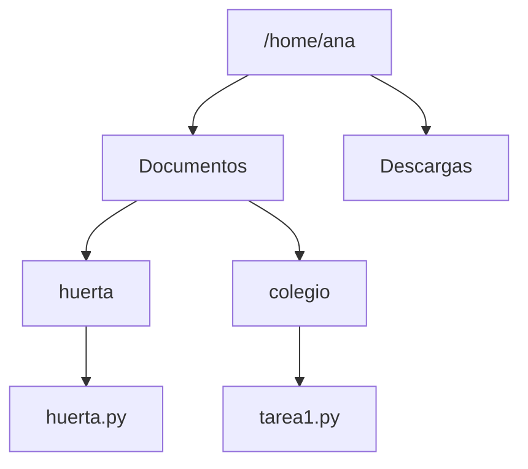
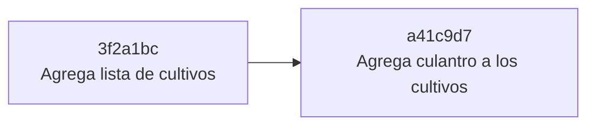
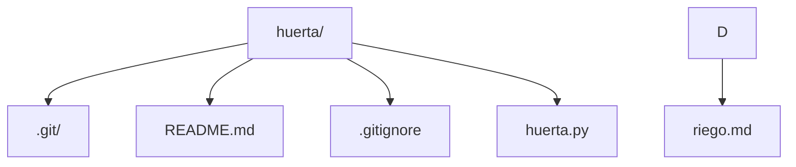

# :material-git: Clase 11

Hasta ahora, cada programa vivió en una carpeta de la computadora y cada cambio reemplazó al anterior.
Sin embargo, cuando un proyecto crece aparecen preguntas que un archivo suelto no puede responder: qué se modificó ayer, cómo volver a una versión que sí funcionaba y cómo compartir el código con otra persona sin enviar copias por correo.

## Control de versiones

Un **sistema de control de versiones** registra los cambios de un proyecto a lo largo del tiempo y permite consultar o recuperar cualquier estado anterior.
Para ver por qué hace falta, basta imaginar la carpeta de un estudiante que guarda una copia por cada cambio importante.

```
huerta.py
huerta_nuevo.py
huerta_final.py
huerta_final_v2.py
huerta_final_v2_ahora_si.py
```

Esta carpeta no dice qué cambió entre una copia y otra, ni cuál es la buena, ni quién la modificó.
Un sistema de control de versiones resuelve esos tres problemas con un solo archivo de trabajo y una historia ordenada de cambios.

!!! note "Git y GitHub no son lo mismo"

    **Git** es el sistema de control de versiones más usado y funciona en la computadora de cada persona, sin necesidad de internet.
    En cambio, **GitHub** es un sitio web que aloja copias de repositorios de Git, de modo que sirve para respaldar el trabajo y compartirlo.
    Por lo tanto, Git es la herramienta y GitHub es un lugar donde se guardan los proyectos hechos con esa herramienta.

## La terminal

Git se usa escribiendo comandos en la **terminal**, una ventana donde se le dan órdenes a la computadora con texto en lugar de con el mouse.
Hasta ahora, los programas se ejecutaron desde un editor, pero para trabajar con Git hace falta saber moverse por las carpetas desde la terminal y entender dónde está cada archivo.

> En Windows se recomienda abrir Git Bash, que se instala junto con Git y usa los mismos comandos que macOS y Linux.

### El directorio actual

La terminal siempre está situada en una carpeta, llamada **directorio actual** o directorio de trabajo y los comandos actúan sobre ella.
Al abrirla, esa carpeta suele ser la carpeta personal del usuario, y el comando `pwd` (*print working directory*) muestra cuál es.
Cada comando se escribe en la terminal y se ejecuta al presionar ++enter++.

```bash
pwd
```

``` title="Salida"
/home/ana
```

> Esto importa para Git porque un comando como `git status` solo sabe de qué proyecto se habla si la terminal está parada dentro de la carpeta de ese proyecto.

### Rutas

Una **ruta** es la dirección de un archivo o una carpeta dentro de la computadora, escrita como una secuencia de carpetas separadas por `/`.
Para ver cómo se leen, se usa el siguiente árbol de carpetas, que es el que aparece en el resto de la clase.



Una ruta que comienza con `/` y describe todo el camino desde la raíz se llama **ruta absoluta**, y funciona igual sin importar dónde esté parada la terminal.
La ruta de `huerta.py` se obtiene recorriendo el árbol desde la raíz hasta el archivo y resulta en: `/home/ana/Documentos/huerta/huerta.py`.

Por otro lado, una **ruta relativa** se escribe a partir del directorio actual y no empieza con `/`.
Si la terminal está en `/home/ana/Documentos`, la ruta relativa de ese mismo archivo es `huerta/huerta.py`.

Además, existen tres símbolos que sirven de atajo en cualquier ruta:

```
.     La carpeta actual
..    La carpeta que contiene a la actual (un nivel hacia arriba)
~     La carpeta personal del usuario, aquí /home/ana
```

Por ejemplo, desde `/home/ana/Documentos/huerta`, la ruta `..` equivale a `/home/ana/Documentos` y la ruta `../colegio` equivale a `/home/ana/Documentos/colegio`.

!!! note "Rutas en Windows"

    Windows escribe las rutas con letra de unidad y barras invertidas, por ejemplo `C:\Users\ana\Documentos`.
    Git Bash las muestra al estilo de Linux, como `/c/Users/ana/Documentos`.

### Moverse y ver contenidos

El comando `ls` lista el contenido de la carpeta actual y el comando `cd` (*change directory*) cambia el directorio actual.

```bash
cd Documentos    # (1)!
ls               # (2)!
cd huerta        # (3)!
pwd              # (4)!
```

1. Entra a la carpeta `Documentos`, escrita como ruta relativa a `/home/ana`.
2. Lista el contenido de `Documentos`.
3. Entra a la carpeta `huerta`, que está dentro de la anterior.
4. Confirma dónde quedó parada la terminal.

``` title="Salida"
colegio  huerta
/home/ana/Documentos/huerta
```

El comando `cd` acepta cualquier tipo de ruta, así que existen varias formas de ir a la carpeta `colegio` desde `huerta`.

=== "Con `..`"
    ```bash
    cd ../colegio
    ```

=== "Subiendo y bajando"
    ```bash
    cd ..
    cd colegio
    ```

=== "Ruta absoluta"
    ```bash
    cd /home/ana/Documentos/colegio
    ```

=== "Desde la carpeta personal"
    ```bash
    cd ~/Documentos/colegio
    ```

Si se escribe `cd` sin ninguna ruta, la terminal regresa a la carpeta personal, lo que sirve para recuperarse cuando alguien se pierde.

!!! tip "Autocompletar con ++tab++"

    Al escribir las primeras letras de una carpeta y presionar ++tab++, la terminal completa el nombre.
    Esto ahorra tiempo y evita errores de escritura.

!!! tip "Repetir y cancelar comandos"

    Al presionar ++arrow-up++, la terminal muestra el comando anterior, lo que evita volver a escribirlo.
    Si un comando se queda ejecutando y no devuelve el control, ++ctrl+c++ lo cancela.

### Crear carpetas y archivos

El comando `mkdir` crea una carpeta nueva dentro del directorio actual.
Para los archivos, lo habitual es crearlos con el editor, pero la terminal también permite crear uno con texto desde un comando.

```bash
mkdir pruebas                     # (1)!
cd pruebas
echo "print('hola')" > hola.py    # (2)!
ls
cat hola.py                       # (3)!
```

1. Crea la carpeta `pruebas` dentro del directorio actual.
2. Escribe el texto en el archivo `hola.py`, y lo crea si no existe o lo reemplaza si ya existe.
3. Muestra el contenido de un archivo.

``` title="Salida"
hola.py
print('hola')
```

!!! danger "Borrar no tiene papelera de reciclaje"

    El comando `rm archivo` elimina un archivo de forma definitiva, sin pasar por la papelera de reciclaje.
    Por esa razón, antes de borrar conviene revisar con `pwd` y `ls` que se está en la carpeta correcta.

### Nombres con espacios y otros detalles

La terminal separa cada comando en palabras usando los espacios, por lo que un nombre que contiene espacios se interpreta como varios nombres distintos.

> Por ejemplo, si existe una carpeta llamada `Mis Documentos`, el comando `cd Mis Documentos` falla, porque la terminal entiende que se pidió entrar a `Mis` y que `Documentos` es un dato adicional.

```bash
cd Mis Documentos
```

``` title="Salida"
bash: cd: too many arguments
```

Para indicar que el espacio forma parte del nombre, hay dos soluciones.

=== "Con comillas"
    Se escribe el nombre completo entre comillas.

    ```bash
    cd "Mis Documentos"
    ```

=== "Con barra invertida"
    Se escribe `\` antes de cada espacio, lo que le indica a la terminal que ese espacio no separa palabras.

    ```bash
    cd Mis\ Documentos
    ```

Además de los espacios, hay otros detalles que causan errores frecuentes al escribir nombres:

- **Mayúsculas y minúsculas:** `Huerta` y `huerta` son carpetas distintas, así que `cd huerta` falla si la carpeta se llama `Huerta`.
- **Tildes y la letra ñ:** funcionan en la mayoría de los casos, pero pueden aparecer mal en algunos programas y sistemas, por lo que conviene evitarlas.
- **Extensiones:** el nombre de un archivo incluye su extensión.

Por estas razones, al crear carpetas y archivos que se van a usar con la terminal y con Git, conviene escribir los nombres en minúscula, sin espacios ni tildes, y unir las palabras con guion bajo.

### ¿Cómo se relaciona con Git?

Un repositorio de Git es, en el fondo, una carpeta común con una subcarpeta oculta `.git`.
Los archivos que empiezan con punto (ocultos) no aparecen en un `ls` normal, pero se pueden ver con `ls -a`.

Cuando se ejecuta un comando de Git, este busca la carpeta `.git` empezando por el directorio actual y subiendo por las carpetas que lo contienen.
Por lo tanto, un comando de Git funciona en cualquier subcarpeta del proyecto, pero falla si la terminal está fuera de él.

``` title="Salida"
fatal: not a git repository (or any of the parent directories): .git
```

Este mensaje es el error más común de quienes empiezan, y casi siempre significa que falta ejecutar `cd` hacia la carpeta del proyecto.

## Configuración inicial

Cada cambio guardado en Git lleva el nombre y el correo de quien lo hizo.
Por esa razón, antes de usar Git por primera vez, hay que indicar esos datos con dos comandos.

```bash
git config --global user.name "Ana Ejemplo"        # (1)!
git config --global user.email "ana@ejemplo.com"   # (2)!
```

1. Define el nombre que aparecerá como autor de los cambios.
2. Define el correo asociado a los cambios, que conviene que sea el mismo de la cuenta de GitHub.

La opción `--global` guarda estos datos para todos los proyectos de la computadora, por lo que este paso se hace una sola vez.

> Para comprobar que Git los recibió, el comando `git config --list` muestra la configuración actual.

## Inicializar un repositorio

Un **repositorio** es una carpeta de proyecto cuya historia de cambios es administrada por Git.
Para convertir una carpeta común en un repositorio, se entra a ella desde la terminal y se ejecuta `git init`.
En este caso, Ana abre la terminal en la carpeta `Documentos` y crea ahí la carpeta del proyecto.

```bash
mkdir huerta    # (1)!
cd huerta       # (2)!
git init        # (3)!
```

1. Crea la carpeta del proyecto.
2. Entra a la carpeta.
3. Crea dentro de la carpeta una subcarpeta oculta llamada `.git`, donde Git guarda toda la historia.

``` title="Salida"
Initialized empty Git repository in /home/ana/Documentos/huerta/.git/
```

La carpeta `.git` es el repositorio en sí, así que borrarla elimina toda la historia del proyecto y deja los archivos como una carpeta común.
Por esa razón, no se debe modificar ni borrar a mano.

## Las tres zonas de Git

Git no guarda los cambios apenas se modifica un archivo, sino que exige que la persona decida qué cambios forman cada versión.
Para lograrlo, el trabajo pasa por tres zonas: el **directorio de trabajo**, donde se editan los archivos; el **área de preparación** (*staging area*), donde se eligen los cambios que irán en la próxima versión; y el **repositorio**, donde quedan guardadas las versiones.


Una versión guardada se llama **commit** y contiene un _snapshot_ de los archivos preparados, además de un mensaje, el autor y la fecha.
La separación en dos pasos permite, por ejemplo, modificar tres archivos y guardar en un commit solo los dos que están relacionados.

### Revisar el estado

El comando `git status` indica en qué zona está cada archivo.
Ana crea el archivo `huerta.py` dentro de la carpeta, con el siguiente contenido:

```python
cultivos = ["tomate", "lechuga", "chile"]
for cultivo in cultivos:
    print(cultivo)
```

Después de crearlo, `git status` indica lo siguiente:

``` title="Salida"
On branch main

No commits yet

Untracked files:
  (use "git add <file>..." to include in what will be committed)
	huerta.py

nothing added to commit but untracked files present (use "git add" to track)
```

El archivo aparece como **untracked** porque existe en el directorio de trabajo, pero Git todavía no lo sigue.

### Preparar con `git add`

El comando `git add` mueve un archivo al área de preparación.

```bash
git add huerta.py
git status
```

``` title="Salida"
On branch main

No commits yet

Changes to be committed:
  (use "git rm --cached <file>..." to unstage)
	new file:   huerta.py

```

Ahora el archivo aparece en *Changes to be committed*, lo que significa que formará parte del próximo commit.

!!! tip "Agregar todo de una vez"

    El comando `git add .` prepara todos los cambios de la carpeta actual.
    Es cómodo, pero puede incluir por accidente archivos que no pertenecen al proyecto, así que es una buena costumbre revisar `git status` antes de confirmar.

### Guardar con `git commit`

El comando `git commit` convierte lo preparado en una versión de la historia y la opción `-m` permite escribir el mensaje en la misma línea.

```bash
git commit -m "Agrega lista de cultivos"
```

``` title="Salida"
[main (root-commit) 3f2a1bc] Agrega lista de cultivos
 1 file changed, 3 insertions(+)
 create mode 100644 huerta.py
```

El texto `3f2a1bc` es el identificador abreviado del commit y `root-commit` indica que es el primero del repositorio.
Un buen mensaje describe qué hace el cambio, de forma que quien lea la historia entienda el proyecto sin abrir el código.

Después de un commit, el directorio de trabajo y la última versión guardada coinciden, y `git status` lo indica con un mensaje de estado limpio.

```bash
git status
```

``` title="Salida"
On branch main
nothing to commit, working tree clean
```

Un estado limpio significa que no hay cambios pendientes, ni sin preparar ni preparados, así que es el punto de partida habitual antes de empezar a modificar archivos.

!!! warning "No olvidar la opción `-m`"

    Si se ejecuta `git commit` sin `-m`, Git abre un editor de texto en la terminal, normalmente Vim, para escribir el mensaje.
    Para salir sin guardar, se presiona ++esc++, luego se escribe `:q!` y se presiona ++enter++.
    Después se vuelve a ejecutar el comando con `-m`.

!!! danger "Mensajes que no ayudan"

    Un mensaje como `cambios`, `arreglo` o `asdf` obliga a abrir cada commit para saber qué contiene.
    En cambio, `Agrega lista de cultivos` o `Corrige el cálculo del total` dicen exactamente qué ocurrió.

### Ver la historia

Para que la historia tenga más de una versión, Ana agrega un cultivo nuevo a la lista de `huerta.py`.
El comando `git diff` muestra lo que cambió en el directorio de trabajo respecto a la última versión guardada.

```bash
git diff
```

```diff title="Salida"
diff --git a/huerta.py b/huerta.py
index 8c1d2e4..b7a9f30 100644
--- a/huerta.py
+++ b/huerta.py
@@ -1,3 +1,3 @@
-cultivos = ["tomate", "lechuga", "chile"]
+cultivos = ["tomate", "lechuga", "chile", "culantro"]
 for cultivo in cultivos:
     print(cultivo)
```

La línea que empieza con `-` es la versión anterior y la que empieza con `+` es la nueva.
Luego, Ana prepara y guarda el cambio con los mismos dos comandos de antes.

```bash
git add huerta.py
git commit -m "Agrega culantro a los cultivos"
git log --oneline    # (1)!
```

1. Muestra la historia con una línea por commit, del más reciente al más antiguo.

``` title="Salida"
a41c9d7 Agrega culantro a los cultivos
3f2a1bc Agrega lista de cultivos
```

El repositorio ahora contiene dos versiones, y cualquiera de ellas puede consultarse por su identificador.



### Descartar cambios

Uno de los motivos para usar Git es poder volver atrás cuando algo sale mal.
Por ejemplo, Ana modifica `huerta.py` y borra por accidente la línea del `for`, de modo que `git status` muestra el archivo como modificado.

``` title="Salida"
On branch main
Changes not staged for commit:
  (use "git add <file>..." to update what will be committed)
  (use "git restore <file>..." to discard changes in working directory)
	modified:   huerta.py

no changes added to commit (use "git add" and/or "git commit -a")
```

El comando `git restore` descarta los cambios de un archivo y lo deja como estaba en la última versión guardada.

```bash
git restore huerta.py
git status
```

``` title="Salida"
On branch main
nothing to commit, working tree clean
```

El archivo recupera su contenido del último commit y el estado vuelve a ser limpio.

!!! danger "Lo descartado no se puede recuperar"

    Los cambios que no se guardaron en un commit se pierden para siempre al ejecutar `git restore`, porque Git no tiene ninguna versión de ellos.
    Por esa razón, conviene revisar con `git diff` qué se va a descartar antes de hacerlo.

El mismo comando sirve en otras dos situaciones.
La primera es sacar un archivo del área de preparación sin perder sus cambios, y la segunda es recuperar un archivo tal como estaba en un commit anterior, indicado por su identificador.

=== "Quitar de la preparación"
    Si Ana ejecutó `git add huerta.py` pero se arrepiente, la opción `--staged` devuelve el archivo al directorio de trabajo con sus cambios intactos.

    ```bash
    git restore --staged huerta.py
    ```

=== "Recuperar una versión anterior"
    Con la opción `--source`, el archivo vuelve a como estaba en el commit `3f2a1bc`, que no incluía el culantro.

    ```bash
    git restore --source=3f2a1bc huerta.py
    ```

## Repositorios remotos con GitHub

Por ahora, la historia existe solo en la computadora de Ana, por lo que un disco dañado o una computadora perdida la eliminaría.
Un **repositorio remoto** es una copia del repositorio guardada en otro lugar, como GitHub, y sirve de respaldo y de punto para compartir el proyecto.

### Crear el repositorio en GitHub

En el sitio de GitHub, Ana crea un repositorio nuevo llamado `huerta`, sin marcar las opciones que agregan archivos iniciales, para que quede vacío.
GitHub entonces muestra la dirección del repositorio, que tiene esta forma.

```
https://github.com/ana-ejemplo/huerta.git
```

### Conectar y subir con git push

El repositorio local todavía no sabe que existe uno remoto, así que primero se registra su dirección con un nombre.
Por convención, el remoto principal se llama `origin`.

```bash
git remote add origin https://github.com/ana-ejemplo/huerta.git # (1)!
git branch -M main                                              # (2)!
git push -u origin main                                         # (3)!
```

1. Registra la dirección con el nombre `origin`.
2. Asegura que la línea principal de la historia se llame `main`, el mismo nombre que usa GitHub.
3. Envía los commits al remoto, y la opción `-u` recuerda este destino para los siguientes envíos.

``` title="Salida"
To https://github.com/ana-ejemplo/huerta.git
 * [new branch]      main -> main
branch 'main' set up to track 'origin/main'.
```

Gracias a `-u`, en los envíos posteriores basta con escribir `git push`.
Al actualizar la página del repositorio en GitHub, aparecen `huerta.py` y los dos commits.

!!! warning "Autenticación en GitHub"

    La primera vez que se ejecuta `git push`, GitHub necesita comprobar quién envía los cambios.
    En Windows, Git Bash abre una ventana del navegador para iniciar sesión en GitHub, y después guarda las credenciales, por lo que no vuelven a pedirse.

## Clonar y actualizar un proyecto

Subir un proyecto es solo la mitad del trabajo, porque otra computadora, otra persona o la misma Ana en la casa necesita obtener esa copia.
El comando `git clone` descarga un repositorio completo, con toda su historia, desde una dirección.

```bash
git clone https://github.com/ana-ejemplo/huerta.git
```

``` title="Salida"
Cloning into 'huerta'...
remote: Enumerating objects: 6, done.
remote: Total 6 (delta 0), reused 6 (delta 0), pack-reused 0
Receiving objects: 100% (6/6), done.
```

Git crea la carpeta `huerta` con los archivos y la carpeta `.git` dentro, y además deja configurado el remoto `origin`, de modo que no hace falta `git init` ni `git remote add`.
La clonación se hace en otra computadora o en otra carpeta, porque Git no permite clonar sobre una carpeta `huerta` que ya existe y tiene archivos.

!!! tip "Lo más común es empezar en GitHub"

    En la práctica, lo habitual es crear primero el repositorio en GitHub y luego clonarlo, en lugar de ejecutar `git init` en la computadora y conectarlo después.
    Así, el remoto `origin` queda configurado desde el inicio y se evitan los pasos de `git remote add` y `git branch -M main`.

### Traer cambios con git pull

Luego de clonar, la copia puede quedar desactualizada si alguien sube commits nuevos al remoto.
Por ejemplo, Ana agrega un cultivo desde la copia clonada, lo guarda con `add` y `commit`, y lo sube con `git push`.
La carpeta original no se entera de esa novedad hasta que se ejecute `git pull`, que descarga los commits nuevos y los incorpora al directorio de trabajo.

```bash
git pull
```

``` title="Salida"
Updating a41c9d7..5be02f1
Fast-forward
 huerta.py | 2 +-
 1 file changed, 1 insertion(+), 1 deletion(-)
```

Si no hay nada nuevo, Git responde `Already up to date.` y no cambia nada.


El ciclo habitual de trabajo con un remoto consiste entonces en traer los cambios con `git pull`, modificar los archivos, prepararlos con `git add`, guardarlos con `git commit` y enviarlos con `git push`.

!!! tip "Hacer pull antes de empezar"

    Ejecutar `git pull` al comenzar cada sesión de trabajo asegura que se parte de la versión más reciente.
    Más adelante se verá qué ocurre cuando dos personas modifican las mismas líneas.

## Estructura de un repositorio

Hasta ahora, el repositorio de Ana solo contiene `huerta.py`.
Sin embargo, quien abre un repositorio en GitHub por primera vez, no conoce el proyecto.
Si no encuentra qué hace el programa ni cómo ejecutarlo, tiene que abrir los archivos uno por uno para averiguarlo.
Por esa razón, un repositorio ordenado incluye, aparte del código, archivos que lo explican y lo mantienen limpio.

### ¿Qué contiene un repositorio ordenado?

| Elemento | Qué contiene |
|----------|--------------|
| `README.md` | Descripción del proyecto y cómo usarlo |
| `.gitignore` | Lista de archivos que Git debe ignorar |
| `LICENSE` | Permisos de uso y copia del código |
| Archivos de código | El programa |

Al terminar esta sección, el proyecto de Ana tendrá la siguiente estructura:



> En esta clase se crean `README.md` y `.gitignore`, que son los que conviene tener en cualquier proyecto del curso.
> El archivo `LICENSE` se agrega cuando un proyecto se publica para que otras personas lo reutilicen.

### El archivo `README.md`

El **`README.md`** es el archivo que presenta el proyecto.
GitHub lo reconoce por su nombre y muestra su contenido automáticamente debajo de la lista de archivos, de modo que es lo primero que ve cualquier visitante.

### Escribir en Markdown

**Markdown** es una forma de escribir texto con formato usando solo símbolos del teclado.
No necesita un programa especial, porque es texto plano que GitHub y otras herramientas convierten en títulos, listas y enlaces.

La siguiente tabla reúne la sintaxis que se usa en casi todos los README:

| Para obtener | Se escribe |
|--------------|------------|
| Título principal | `# Título` |
| Sección | `## Sección` |
| **Negrita** | `**texto**` |
| *Cursiva* | `*texto*` |
| Código dentro de una oración | ``` `python huerta.py` ``` |
| Lista con viñetas | `- elemento` |
| Lista numerada | `1. paso` |
| Enlace | `[texto](https://github.com)` |

Además, Markdown ignora un salto de línea simple dentro de un párrafo, por lo que para separar párrafos, títulos o listas hay que dejar una línea en blanco.

### Crear el README

Ana crea el archivo `README.md` en la carpeta del proyecto, con un editor de texto, y escribe lo siguiente.

````markdown title="README.md"
# Huerta

Programa en Python que muestra los cultivos de una huerta escolar.

## Cómo ejecutarlo

1. Instalar Python 3.
2. Abrir la terminal en la carpeta del proyecto.
3. Escribir el siguiente comando:

```bash
python huerta.py
```

## Autora

Ana Ejemplo
````

El README es un archivo más del repositorio, así que se guarda y se envía como cualquier otro cambio.

```bash
git add README.md
git commit -m "Agrega README con instrucciones de uso"
git push
```

``` title="Salida del commit"
[main 8d03e5a] Agrega README con instrucciones de uso
 1 file changed, 17 insertions(+)
 create mode 100644 README.md
```

### Ignorar archivos con `.gitignore`

Hay archivos que existen en la carpeta del proyecto, pero que no deben subirse a GitHub.
Algunos son temporales, como la carpeta `__pycache__` que Python crea al importar módulos, y otros son privados, como un archivo con contraseñas.
Mientras Git no sepa que debe ignorarlos, `git status` lo muestra como un archivo pendiente.

``` title="Salida"
On branch main
Your branch is up to date with 'origin/main'.

Untracked files:
  (use "git add <file>..." to include in what will be committed)
	claves.txt

nothing added to commit but untracked files present (use "git add" to track)
```

Este es el riesgo que advirtió el consejo sobre `git add .`, ya que ese comando prepararía `claves.txt`, por ejemplo, junto con todo lo demás.
La solución es crear un archivo `.gitignore` con un patrón por línea: uno para cada archivo o grupo de archivos que Git debe pasar por alto.

```title=".gitignore"
claves.txt
*.log
__pycache__/
```

Después de crear `.gitignore`, `git status` ya no menciona `claves.txt`, y el único archivo pendiente es el propio `.gitignore`, que sí debe guardarse en el repositorio para que todos usen las mismas reglas.

``` title="Salida"
On branch main
Your branch is up to date with 'origin/main'.

Untracked files:
  (use "git add <file>..." to include in what will be committed)
	.gitignore

nothing added to commit but untracked files present (use "git add" to track)
```

```bash
git add .gitignore
git commit -m "Agrega .gitignore"
git push
```

## Ejercicios prácticos

### Moverse por las carpetas

=== "Enunciado"
    La terminal de Ana está parada en `/home/ana/Documentos/huerta`, con el árbol de carpetas de la clase.

    1. Escriba la ruta absoluta de `tarea1.py`.
    2. Escriba un `cd` con ruta relativa para ir a `colegio` y otro con ruta absoluta.
    3. Escriba la ruta relativa de `tarea1.py` desde `/home/ana/Documentos`.

=== "Solución"
    1. La ruta absoluta de `tarea1.py` es `/home/ana/Documentos/colegio/tarea1.py`.
    2. Con ruta relativa, el comando es `cd ../colegio`, porque `..` sube a `Documentos` y desde allí se baja a `colegio`.
        Con ruta absoluta, el comando es `cd /home/ana/Documentos/colegio`.
    3. Desde `/home/ana/Documentos`, la ruta relativa de `tarea1.py` es `colegio/tarea1.py`.

### Identificar la zona

=== "Enunciado"
    Ana ejecuta, en orden, los siguientes comandos dentro de un repositorio que ya tiene un commit.

    ```bash
    echo "print('riego')" > riego.py
    git add riego.py
    echo "print('cosecha')" > cosecha.py
    git status
    ```

    1. Indique en qué zona queda cada archivo, `riego.py` y `cosecha.py`, al ejecutar `git status`.
    2. Indique qué archivos se guardarían si ahora Ana ejecutara `git commit -m "Agrega riego"`.
    3. Indique qué comando falta para que `cosecha.py` también quede en el commit.

=== "Solución"
    1. El archivo `riego.py` está en el área de preparación, bajo **Changes to be committed**, porque fue agregado con `git add`.
        En cambio, `cosecha.py` está en el directorio de trabajo como **untracked**, ya que nunca se preparó.
    2. El commit guardaría únicamente `riego.py`, pues `git commit` solo toma lo que está en el área de preparación.
    3. Para incluir `cosecha.py`, falta ejecutar `git add cosecha.py` antes del commit.

### Corregir los errores

=== "Enunciado"
    Marcos escribió esta secuencia para empezar a trabajar con un proyecto que ya existe en GitHub, pero tiene tres errores.

    ```bash
    git init
    git remote add origin https://github.com/marcos-r/robot.git
    git commit -m "Primer cambio"
    git push
    ```

    1. Indique cuál comando sobra o cuál debería reemplazarlo si el proyecto ya existe en GitHub.
    2. Indique qué comando falta.
    3. Explique qué diferencia hay entre `git pull` y `git clone`.

=== "Solución"
    1. Como el proyecto ya existe en GitHub, `git init` y `git remote add` sobran, y el comando correcto es `git clone https://github.com/marcos-r/robot.git`, que crea la carpeta y deja configurado el remoto.
    2. Falta `git add archivo`, porque sin archivos preparados `git commit` responde que no hay nada para guardar.
        Además, todo cambio nuevo debe prepararse antes de cada commit.
    3. El comando `git clone` se usa una vez, para obtener por primera vez un repositorio completo.
        En cambio, `git pull` se usa en una copia que ya existe, para traer los commits nuevos del remoto.

### Deshacer cambios

=== "Enunciado"
    Ana tiene un repositorio con el archivo `huerta.py` ya guardado en un commit.
    Luego modifica el archivo y ejecuta `git add huerta.py`, pero se da cuenta de que el cambio estaba mal.

    1. Indique qué comando saca el archivo del área de preparación sin perder el cambio.
    2. Indique qué comando descarta el cambio y deja el archivo como en el último commit.
    3. Indique cómo sabría Ana que el estado volvió a ser limpio.

=== "Solución"
    1. El comando es `git restore --staged huerta.py`.
    2. El comando es `git restore huerta.py`, que debe ejecutarse después del anterior porque el cambio sigue en el directorio de trabajo.
    3. Ana ejecuta `git status`, que responde `nothing to commit, working tree clean`.

### Leer la historia

=== "Enunciado"
    Este es el resultado de `git log --oneline` en el repositorio de una calculadora.

    ``` title="Salida"
    c9e4f12 Corrige la división entre cero
    7b30a8d Agrega la opción de potencia
    1d5c6e3 Agrega suma y resta
    ```

    1. Indique cuántas versiones tiene el proyecto y cuál es la más antigua.
    2. Indique qué comando mostraría las líneas exactas que cambió el commit `c9e4f12`, antes de guardarlo.
    3. Explique por qué es posible ejecutar `git add` más veces que la cantidad de commits.

=== "Solución"
    1. El proyecto tiene tres versiones, y la más antigua es `1d5c6e3 Agrega suma y resta`, porque `git log` lista primero la más reciente.
    2. El comando `git diff`, ejecutado antes de `git add`, muestra las líneas modificadas en el directorio de trabajo respecto a la última versión guardada.
    3. Es posible ejecutar `git add` más veces que commits porque cada `git add` solo prepara cambios.
        Además, varios `git add` pueden sumarse en un mismo commit o repetirse sobre un archivo antes de guardar.
