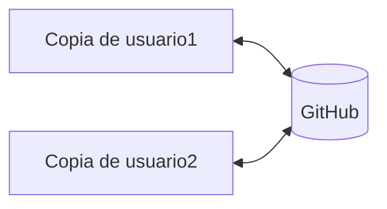
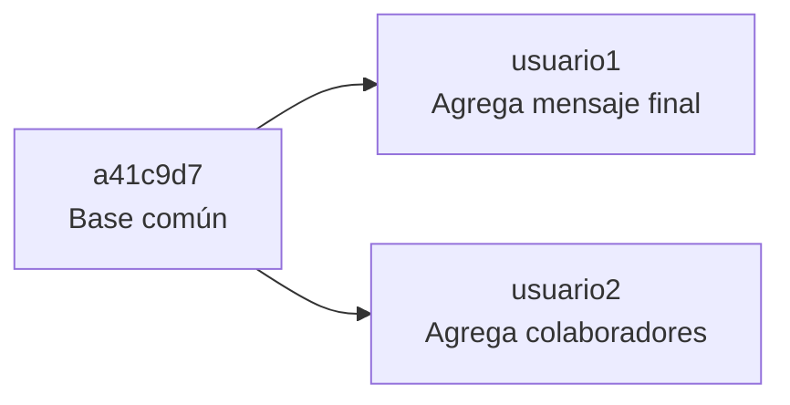
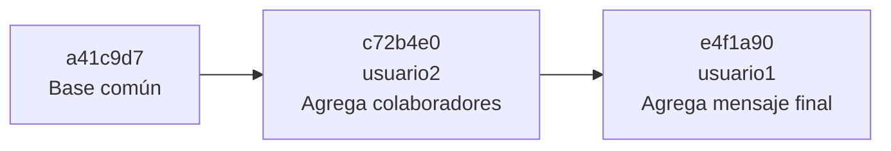
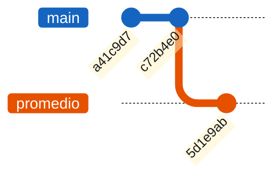
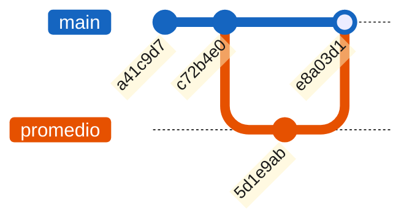
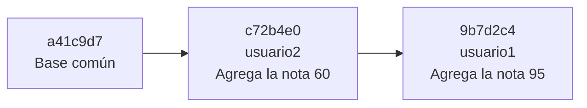

# :material-source-branch: Clase 12

En la clase anterior, cada repositorio tenía una sola persona que modificaba los archivos y los subía a GitHub.
Sin embargo, casi todo proyecto real lo construye un equipo, donde varias personas cambian el mismo código al mismo tiempo.
Esto plantea tres preguntas: cómo se reparte el trabajo, cómo se juntan los cambios de cada persona y qué ocurre cuando dos personas modifican las mismas líneas.
Esta clase responde cada una con colaboradores, ramas, pull requests y la resolución de conflictos.

## Colaborar en un repositorio

Un repositorio de GitHub pertenece a una cuenta, y solo esa cuenta puede enviarle cambios con `git push`.
Para trabajar en equipo, la dueña del repositorio invita a las demás personas como **colaboradoras**, que reciben permiso para subir commits.

### Invitar a una persona colaboradora

`usuario1` quiere que `usuario2` participe en `notas`.
La invitación se hace desde la página del repositorio en GitHub, con los siguientes pasos:

#### Paso 1: Abrir los ajustes

En el repositorio, `usuario1` entra a **Settings** y luego a **Collaborators**.

#### Paso 2: Enviar la invitación

`usuario1` presiona **Add people**, escribe `usuario2` y confirma.
GitHub envía una invitación al correo de `usuario2`.

#### Paso 3: Aceptar y clonar

`usuario2` acepta la invitación y clona el repositorio en su computadora, con el mismo comando de la clase anterior.

```bash
git clone https://github.com/usuario1/notas.git
```

A partir de ese momento existen tres copias del repositorio: la de `usuario1`, la de `usuario2` y la de GitHub, que sirve de punto de encuentro.



!!! note "Colaboradora o fork"

    Una persona colaboradora necesita una invitación, así que este método sirve para equipos que se conocen, como un grupo de clase.
    Cuando alguien quiere proponer un cambio a un proyecto ajeno, GitHub ofrece hacer un **fork**, que es una copia propia del repositorio donde sí se tiene permiso para escribir.
    Por ahora, se trabaja solo con colaboradores.

### Cuando el push es rechazado

`usuario2` agrega al final de `README.md` una sección de colaboradores, la guarda con `add` y `commit`, y la sube con `git push`.
Mientras tanto, `usuario1` modifica `notas.py`, y también guarda su cambio con `add` y `commit`.
Cuando `usuario1` intenta subirlo, GitHub no lo acepta.

```bash
git push
```

``` title="Salida"
To https://github.com/usuario1/notas.git
 ! [rejected]        main -> main (fetch first)
error: failed to push some refs to 'https://github.com/usuario1/notas.git'
hint: Updates were rejected because the remote contains work that you do not
hint: have locally. This is usually caused by another repository pushing to
hint: the same ref. If you want to integrate the remote changes, use
hint: 'git pull' before pushing again.
```

El rechazo ocurre porque GitHub tiene un commit de `usuario2` que la copia de `usuario1` no conoce.
Si Git aceptara el envío de `usuario1`, el commit de `usuario2` desaparecería de la rama, así que protege el trabajo exigiendo que `usuario1` primero lo incorpore.
En este punto, la historia de las dos copias se separó en dos caminos a partir del mismo commit.



### Actualizar la copia con `git pull`

El comando `git pull` descarga el commit de `usuario2` y coloca encima de él los commits locales de `usuario1`, como si `usuario1` hubiera empezado su trabajo después.
Esta técnica se llama **rebase**, y deja la historia en una sola línea, sin caminos separados.
Antes de usar `git pull` por primera vez conviene indicarle a Git que use rebase, con una configuración que se hace una sola vez.

```bash
git config --global pull.rebase true
```

Luego, `usuario1` trae los cambios.

```bash
git pull
```

``` title="Salida"
From https://github.com/usuario1/notas
   a41c9d7..c72b4e0  main       -> origin/main
Successfully rebased and updated refs/heads/main.
```

Git pudo hacerlo por sí solo porque `usuario1` y `usuario2` modificaron archivos distintos.
El commit de `usuario1` ahora parte del commit de `usuario2`, así que Git lo reescribe con un identificador nuevo, `e4f1a90`, aunque conserva su mensaje y su contenido.



Con la copia al día, el `git push` de `usuario1` ya es aceptado, porque su copia contiene todo lo que tiene GitHub.

!!! tip "Para no ser rechazado..."

    La mejor forma de evitar el rechazo es ejecutar `git pull` antes de empezar a trabajar y también antes de ejecutar `git push`.
    Así la copia local casi siempre está al día con GitHub.

## Ramas

Trabajar todos sobre `main` tiene un problema: cada cambio a medio terminar se mezcla con el trabajo de las demás personas.
Una **rama** es una línea independiente de commits que permite desarrollar un cambio aislado, sin afectar a `main`, hasta que esté listo para unirse.
Hasta ahora, todo el trabajo de la clase ocurrió en una sola rama, llamada `main`.

### Crear y cambiar de rama

`usuario1` quiere agregar un programa que calcula el promedio, y decide hacerlo en una rama llamada `promedio`.
El comando `git switch -c` crea una rama nueva y se mueve a ella, mientras que `git branch` lista las ramas existentes.

```bash
git switch -c promedio    # (1)!
git branch                # (2)!
```

1. Crea la rama `promedio` a partir del commit actual y cambia a ella.
2. Lista las ramas, y el asterisco marca la rama en la que se está trabajando.

``` title="Salida"
Switched to a new branch 'promedio'
  main
* promedio
```

`usuario1` crea el archivo `promedio.py` y lo guarda con los comandos habituales, que ahora registran el commit en la rama `promedio`.

```python
notas = [70, 85, 90, 100]
promedio = sum(notas) / len(notas)
print(promedio)
```

```bash
git add promedio.py
git commit -m "Agrega cálculo del promedio"
```

``` title="Salida"
[promedio 5d1e9ab] Agrega cálculo del promedio
 1 file changed, 3 insertions(+)
 create mode 100644 promedio.py
```

La rama `main` no cambió y la diferencia se puede comprobar volviendo a ella.

```bash
git switch main
ls
```

``` title="Salida"
README.md  notas.py
```

El archivo `promedio.py` no aparece porque pertenece a un commit que solo existe en la rama `promedio`.
Al ejecutar `git switch promedio`, Git cambia los archivos de la carpeta para que coincidan con esa rama, y `promedio.py` reaparece.

En el diagrama, cada punto es un commit y cada línea horizontal es una rama.
La rama `promedio` se separa de `main` a partir del commit `c72b4e0` y su commit nuevo no aparece en `main`.



!!! danger "Guardar antes de cambiar de rama"

    Si hay cambios sin guardar que entran en conflicto con la rama de destino, Git se niega a cambiar y muestra un error.
    Por esa razón, conviene ejecutar `git status` y hacer commit de lo pendiente antes de cambiar de rama.

### Subir una rama

Para que `usuario2` pueda ver la rama de `usuario1`, hay que enviarla a GitHub.
La primera vez, un `git push` simple falla porque la rama nueva todavía no tiene destino en GitHub, y Git sugiere el comando completo.
La opción `--set-upstream` crea la rama en GitHub y recuerda ese destino para los siguientes envíos.

```bash
git push --set-upstream origin promedio
```

``` title="Salida"
remote: Create a pull request for 'promedio' on GitHub by visiting:
remote:      https://github.com/usuario1/notas/pull/new/promedio
To https://github.com/usuario1/notas.git
 * [new branch]      promedio -> promedio
branch 'promedio' set up to track 'origin/promedio'.
```

En este punto, la rama existe en GitHub pero `main` todavía no incluye el cálculo del promedio.
Unir las dos ramas es el paso siguiente.

## Pull requests

Un **pull request**, abreviado PR, es una solicitud para unir una rama con otra, que se crea en GitHub.
El PR no une nada por sí solo, sino que abre un espacio donde el equipo revisa los cambios, hace comentarios y decide si se aceptan.
Gracias a eso, ningún cambio llega a `main` sin que otra persona lo haya visto.

### Abrir y unir el pull request

Después de subir la rama `promedio`, `usuario1` abre el PR con los siguientes pasos.

#### Paso 1: Crear la solicitud

En la página del repositorio, GitHub muestra un aviso con el botón **Compare & pull request**, y `usuario1` lo presiona.

#### Paso 2: Describir el cambio

`usuario1` escribe un título corto, como `Agrega cálculo del promedio`, y una descripción de qué hace el cambio.
Luego presiona **Create pull request**.

#### Paso 3: Revisar

`usuario2` abre la pestaña **Files changed**, donde ve las líneas agregadas en verde y las eliminadas en rojo, y puede dejar comentarios sobre cualquier línea.
Si todo está bien, aprueba el cambio.
Si pide cambios, `usuario1` vuelve a su rama, hace nuevos commits y los sube con `git push`, y el PR se actualiza solo.

#### Paso 4: Unir

`usuario1` presiona **Merge pull request** y luego **Confirm merge**.
GitHub crea un commit de merge en `main`, que une la rama con `main`, y el botón **Delete branch** permite borrar la rama de GitHub, porque su trabajo ya quedó incluido.

### Actualizar la copia local

La fusión ocurrió en GitHub, así que las copias locales todavía no la conocen.
Cada persona vuelve a `main`, trae los cambios y borra la rama local que ya no necesita.

```bash
git switch main
git pull
git branch -d promedio    # (1)!
```

1. La opción `-d` borra la rama local solo si sus cambios ya están unidos a `main`.

``` title="Salida"
Updating c72b4e0..e8a03d1
Fast-forward
 promedio.py | 3 +++
 1 file changed, 3 insertions(+)
 create mode 100644 promedio.py
Deleted branch promedio (was 5d1e9ab).
```

Ahora `promedio.py` forma parte de `main`, y el ciclo está listo para empezar de nuevo con otra rama.
El commit `e8a03d1` es el commit de merge que GitHub creó al unir el pull request, y por eso las dos líneas vuelven a juntarse.



!!! tip "Una rama por cada cambio"

    Cada rama debe tener un propósito claro, como `promedio` o `reporte`, y vivir poco tiempo.
    Las ramas pequeñas son más fáciles de revisar y producen menos conflictos al unirse.

## Manejo de conflictos

Git une los cambios de dos personas sin ayuda mientras estos toquen líneas distintas.
Sin embargo, si ambas modifican la misma línea, Git no puede decidir cuál versión es la correcta, y entrega la decisión a quien está actualizando su copia.
Esa situación se llama **conflicto**.

### Un conflicto paso a paso

Para ver uno, se parte de un archivo `notas.py` cuya primera línea es la siguiente.

```python
notas = [70, 85, 90, 100]
```

`usuario1` y `usuario2`, cada uno en su computadora, modifican esa misma línea de forma distinta.

=== "Cambio de `usuario1`"
    `usuario1` agrega la nota 95 y guarda el cambio, pero todavía no lo sube.

    ```python
    notas = [70, 85, 90, 100, 95]
    ```

    ```bash
    git add notas.py
    git commit -m "Agrega la nota 95"
    ```

=== "Cambio de `usuario2`"
    `usuario2` agrega la nota 60, guarda el cambio y logra subirlo primero.

    ```python
    notas = [70, 85, 90, 100, 60]
    ```

    ```bash
    git add notas.py
    git commit -m "Agrega la nota 60"
    git push
    ```

Cuando `usuario1` intenta subir su commit, GitHub lo rechaza igual que antes, así que ejecuta `git pull` y esta vez Git no puede colocar el commit sobre el de `usuario2`.

```bash
git pull
```

``` title="Salida"
Auto-merging notas.py
CONFLICT (content): Merge conflict in notas.py
error: could not apply 4b2e8f1... Agrega la nota 95
hint: Resolve all conflicts manually, mark them as resolved with
hint: "git add/rm <conflicted_files>", then run "git rebase --continue".
hint: You can instead skip this commit: run "git rebase --skip".
hint: To abort and get back to the state before "git pull", run "git rebase --abort".
Could not apply 4b2e8f1... Agrega la nota 95
```

Git no descartó nada, sino que detuvo el rebase justo en el commit que choca, y espera que `usuario1` lo resuelva.
El comando `git status` lo confirma, porque indica que hay un rebase en curso y lista el archivo bajo *Unmerged paths*.

```bash
git status
```

``` title="Salida"
rebase in progress; onto c72b4e0
Last command done (1 command done):
   pick 4b2e8f1 Agrega la nota 95
No commands remaining.
You are currently rebasing branch 'main' on 'c72b4e0'.
  (fix conflicts and then run "git rebase --continue")
  (use "git rebase --skip" to skip this patch)
  (use "git rebase --abort" to check out the original branch)

Unmerged paths:
  (use "git restore --staged <file>..." to unstage)
  (use "git add <file>..." to mark resolution)
	both modified:   notas.py

no changes added to commit (use "git add" and/or "git commit -a")
```

### Leer las marcas del conflicto

Git escribe dentro del archivo las dos versiones, separadas por unas marcas especiales.
Al abrir `notas.py`, `usuario1` encuentra lo siguiente.

```
<<<<<<< HEAD
notas = [70, 85, 90, 100, 60]
=======
notas = [70, 85, 90, 100, 95]
>>>>>>> 4b2e8f1 (Agrega la nota 95)
for nota in notas:
    print(nota)
```

Cada marca tiene un significado fijo.

| Marca | Significado |
|-------|-------------|
| `<<<<<<< HEAD` | Inicio del conflicto, seguido de la versión que ya está en GitHub, o sea la de `usuario2` |
| `=======` | Separador entre las dos versiones |
| `>>>>>>> 4b2e8f1` | Fin del conflicto, precedido de la versión del commit local que se está colocando, o sea la de `usuario1`, con su identificador y su mensaje |

Las líneas fuera de las marcas, como el `for`, no tienen conflicto y quedaron como están.

### Resolver el conflicto

Resolver un conflicto significa editar el archivo hasta que quede exactamente como debe ser, sin ninguna marca.
Hay tres decisiones posibles, y la correcta depende del significado de los cambios.

=== "Quedarse con la versión de `usuario1`"
    Se borran las marcas y la línea de `usuario2`.
    Esta opción descarta el trabajo de `usuario2`, así que solo es correcta si su cambio sobraba.

    ```python
    notas = [70, 85, 90, 100, 95]
    ```

=== "Quedarse con la versión de `usuario2`"
    Se borran las marcas y la línea de `usuario1`.
    Esta opción descarta el trabajo de `usuario1`, y su commit queda vacío, por lo que se omite con `git rebase --skip`.

    ```python
    notas = [70, 85, 90, 100, 60]
    ```

=== "Combinar ambas"
    Se escribe una línea nueva que contenga los dos cambios.
    Aquí es la opción correcta, porque `usuario1` y `usuario2` querían agregar notas distintas.

    ```python
    notas = [70, 85, 90, 100, 95, 60]
    ```

Después de editar, `usuario1` indica que el conflicto está resuelto y le pide a Git que continúe con el rebase.

```bash
git add notas.py
git rebase --continue
git push
```

``` title="Salida"
[detached HEAD 9b7d2c4] Agrega la nota 95
 1 file changed, 1 insertion(+), 1 deletion(-)
Successfully rebased and updated refs/heads/main.
```

El commit de `usuario1` conserva su mensaje, pero ahora contiene la línea con las dos notas, y el push ya es aceptado.
La historia queda en una sola línea, con el commit de `usuario2` primero y el de `usuario1` después.



!!! danger "Dejar las marcas en el archivo"

    Si `usuario1` ejecuta `git add` sin borrar las marcas, Git acepta el archivo tal cual y las marcas quedan guardadas en el commit.
    Python no entiende esas líneas y el programa deja de funcionar.

    ```
    File "notas.py", line 1
        <<<<<<< HEAD
        ^^
    SyntaxError: invalid syntax
    ```

    Por eso, antes de ejecutar `git add`, se debe buscar `<<<<<<<` en el archivo y comprobar que el programa corre.

!!! tip "Cancelar el rebase"

    Si la situación se complica y `usuario1` prefiere empezar de nuevo, el comando `git rebase --abort` cancela el rebase y deja el repositorio como estaba antes de ejecutar `git pull`.
    No se pierde ningún commit.

### ¿Cuándo aparece un conflicto?

No todo cambio simultáneo produce un conflicto, y conocer la regla ayuda a anticiparlos.

| Situación | ¿Conflicto? | Razón |
|-----------|-------------|-------|
| `usuario1` y `usuario2` editan archivos distintos | No | Git combina los archivos sin ayuda |
| Editan líneas distintas del mismo archivo | No | Git combina las líneas sin ayuda |
| Editan la misma línea con textos distintos | Sí | Git no sabe cuál versión conservar |
| Uno borra una línea y el otro la modifica | Sí | Git no sabe si la línea debe existir |

El mismo tipo de conflicto aparece al unir un pull request, porque dos ramas también pueden cambiar la misma línea.
En ese caso, GitHub avisa que la rama tiene conflictos, y se resuelven en la copia local actualizando la rama con los cambios de `main` antes de volver a subirla.

### ¿Cómo prevenir los conflictos?

Los conflictos no se pueden eliminar, pero sí reducir con unos pocos hábitos.

| Hábito | Efecto |
|--------|--------|
| Ejecutar `git pull` antes de empezar | Se parte de la versión más reciente |
| Hacer commits pequeños y frecuentes | Cada conflicto es más corto y más fácil de leer |
| Usar una rama por cambio | El trabajo de cada persona queda separado hasta la revisión |
| Repartir las tareas por archivo o sección | Dos personas rara vez tocan las mismas líneas |
| Avisar al equipo antes de un cambio grande | Se evita editar en paralelo lo mismo |
