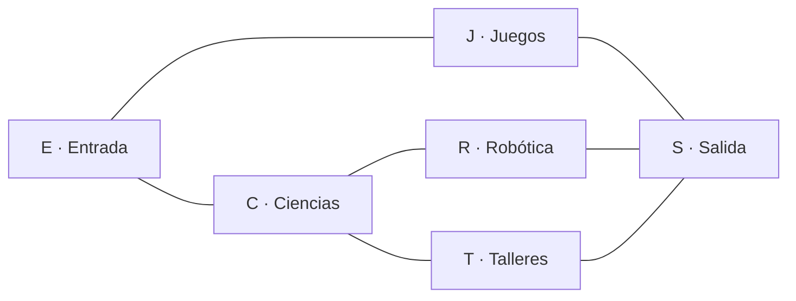

# :material-map-marker-path: Laboratorio 2

## Enunciado

La feria científica del colegio ocupa seis espacios conectados por pasillos.
El equipo de logística necesita un programa que pueda consultar el mapa y recorrer los espacios desde cualquier punto de inicio.

Los espacios se identifican con las siguientes letras.

| Nodo | Espacio |
| ---- | ------- |
| E | Entrada |
| C | Exposición de ciencias |
| J | Zona de juegos |
| R | Robótica |
| T | Talleres |
| S | Salida |

Los pasillos son de doble vía.
Por lo tanto, el mapa es un grafo no dirigido.
Las conexiones son las siguientes.

| Conexión | Conexión |
| -------- | -------- |
| E — C | E — J |
| C — R | C — T |
| J — S | R — S |
| T — S | |



Desarrolle un programa de menú llamado **Mapa de la feria científica**.
El programa debe representar el mapa con una lista de adyacencia y construir su matriz de adyacencia a partir de esa lista.
También debe recorrer el grafo con DFS recursivo e iterativo.

**Menú principal:**

```
=== MAPA DE LA FERIA CIENTÍFICA ===
1. Ver conexiones de un espacio
2. Ver matriz de adyacencia
3. Recorrer con DFS recursivo
4. Recorrer con DFS iterativo
5. Consultar si hay un pasillo directo
6. Salir
```

> Si el usuario ingresa una opción que no está en el menú, el programa debe mostrar un mensaje de error y volver a mostrar el menú.

### Representación inicial del mapa

Construya un diccionario llamado `mapa` con una lista de vecinos para cada nodo.
Respete el orden de vecinos indicado por las conexiones de arriba.
Por ejemplo, los vecinos de E deben quedar en el orden C, J.

Como el grafo es no dirigido, toda conexión debe aparecer en las dos listas correspondientes.
Por ejemplo, si E contiene a C, entonces C también debe contener a E.

Use esta lista para fijar el orden de las filas y columnas de la matriz.

```python
nodos = ["E", "C", "J", "R", "T", "S"]
```

### Opción 1 — Ver conexiones de un espacio

Solicite un nodo y muestre el nombre del espacio junto con sus vecinos directos.
El usuario puede escribir la letra en mayúscula o minúscula.

Si el nodo no existe, muestre `Ese espacio no existe en el mapa.`
No use la matriz en esta opción.
La información debe obtenerse de la lista de adyacencia.

Para E, la salida debe indicar que se conecta directamente con C y J.

### Opción 2 — Ver matriz de adyacencia

Implemente una función `construir_matriz(mapa, nodos)` que retorne una matriz de adyacencia.
La función debe crear una matriz de ceros y colocar un `1` donde exista una conexión directa.

Muestre la matriz con los encabezados de filas y columnas en el orden E, C, J, R, T, S.
No es necesario alinear las columnas con una cantidad fija de espacios, pero cada fila debe ser legible e incluir su nodo.

La diagonal debe tener ceros.
La matriz debe ser simétrica porque los pasillos se pueden recorrer en ambos sentidos.

### Opción 3 — Recorrer con DFS recursivo

Solicite un nodo inicial válido.
Implemente una función `dfs_recursivo(mapa, inicio)` que retorne una lista con el orden de visita.

La función debe usar un conjunto `visitados`.
Debe marcar cada nodo antes de explorar sus vecinos.
Muestre el resultado separando los nodos con ` -> `.

Con el grafo y el orden de vecinos establecidos, iniciar en E debe producir este recorrido.

```
E -> C -> R -> S -> J -> T
```

### Opción 4 — Recorrer con DFS iterativo

Solicite un nodo inicial válido.
Implemente una función `dfs_iterativo(mapa, inicio)` que retorne una lista con el orden de visita.

La función debe usar una lista como pila y `pop()` para extraer el nodo pendiente.
Para conservar el mismo orden de la versión recursiva, recorra los vecinos con `reversed()` antes de agregarlos a la pila.
Si un nodo que sale de la pila ya fue visitado, debe descartarse sin agregarlo otra vez al recorrido.

Con inicio en E, el resultado debe ser igual al de la opción 3.

### Opción 5 — Consultar si hay un pasillo directo

Solicite un nodo de origen y uno de destino.
Valide que ambos existan.

Use la matriz de adyacencia para responder si existe una conexión directa entre ambos espacios.
No use `destino in mapa[origen]` en esta opción.

Por ejemplo, debe indicar que existe un pasillo directo entre C y T.
También debe indicar que no existe uno entre E y S.

### Requisitos técnicos

- El mapa debe representarse como un diccionario de listas de adyacencia.
- El grafo debe ser no dirigido y cada conexión debe aparecer en ambos sentidos.
- La opción 2 debe construir la matriz a partir de la lista de adyacencia.
- La opción 2 no puede escribir una matriz fija directamente en el programa.
- La opción 3 debe implementar DFS mediante recursión y un conjunto `visitados`.
- La opción 4 debe implementar DFS mediante una pila explícita.
- La opción 4 debe usar `reversed()` al agregar vecinos a la pila.
- Las funciones de DFS deben retornar una lista y no imprimir los nodos dentro de la función.
- La opción 5 debe consultar la matriz de adyacencia.
- El menú debe repetirse hasta que el usuario elija la opción 6.
- Todo nodo solicitado debe validarse sin importar mayúsculas o minúsculas.

## Ejemplos de ejecución esperada

=== "Conexiones y matriz"

    ```
    === MAPA DE LA FERIA CIENTÍFICA ===
    1. Ver conexiones de un espacio
    ...
    Opción: 1
    Espacio: c
    C · Exposición de ciencias se conecta con: E, R, T

    Opción: 2

      E C J R T S
    E 0 1 1 0 0 0
    C 1 0 0 1 1 0
    J 1 0 0 0 0 1
    R 0 1 0 0 0 1
    T 0 1 0 0 0 1
    S 0 0 1 1 1 0
    ```

=== "Los dos DFS"

    ```
    Opción: 3
    Nodo inicial: E
    DFS recursivo: E -> C -> R -> S -> J -> T

    Opción: 4
    Nodo inicial: E
    DFS iterativo: E -> C -> R -> S -> J -> T
    ```

=== "Pasillo directo"

    ```
    Opción: 5
    Origen: C
    Destino: T
    Sí existe un pasillo directo entre C y T.

    Opción: 5
    Origen: E
    Destino: S
    No existe un pasillo directo entre E y S.
    ```

=== "Nodo y opción inválidos"

    ```
    Opción: 1
    Espacio: X
    Ese espacio no existe en el mapa.

    Opción: 9
    Opción inválida.
    ```

## Evidencia de configuración

Además del programa, el laboratorio incluye una evidencia que prepara el trabajo con control de versiones en las próximas clases.
Debe adjuntar **dos capturas de pantalla** en la entrega.

### Captura 1: Git instalado

La captura debe mostrar la terminal de su computadora con el resultado de `git --version`.

```
git --version
```

### Captura 2: Cuenta de GitHub

Debe crear una cuenta en [GitHub](https://github.com) y adjuntar una captura de su perfil.
La captura debe mostrar su **nombre de usuario** y su **nombre real**.
La foto de perfil es opcional.

## Rúbrica de evaluación

| Criterio | Puntaje |
| -------- | ------: |
| El diccionario representa todas las conexiones y conserva ambos sentidos | 12 |
| La opción 1 consulta correctamente la lista de adyacencia y valida el nodo | 8 |
| La función construye la matriz a partir de la lista de adyacencia | 15 |
| La opción 2 muestra una matriz correcta, con orden y encabezados definidos | 8 |
| DFS recursivo usa `visitados`, recursión y retorna el orden correcto | 15 |
| DFS iterativo usa una pila, `pop()` y `reversed()` correctamente | 15 |
| Los dos DFS producen el orden esperado desde E | 5 |
| La opción 5 consulta la matriz y responde correctamente para ambos casos | 8 |
| El menú se repite y maneja opciones o nodos inválidos | 4 |
| Captura de `git --version` que muestra Git instalado | 5 |
| Captura del perfil de GitHub con nombre de usuario y nombre real | 5 |
| **Total** | **100** |
