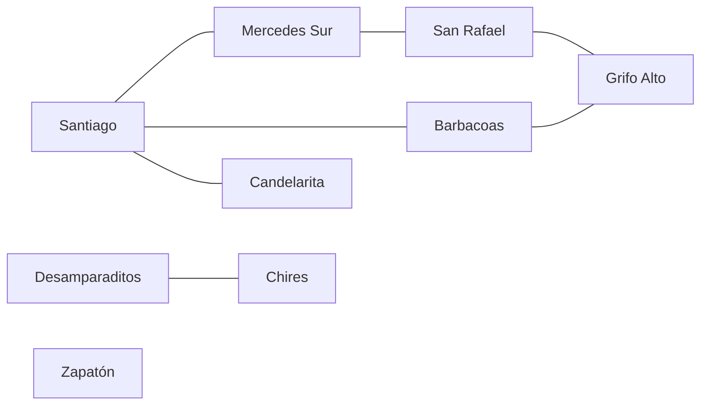
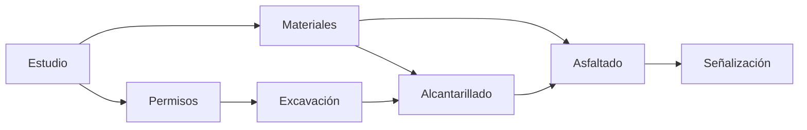

<!-- Colocar formato matemático -->
<script id="MathJax-script" async src="https://unpkg.com/mathjax@3/es5/tex-mml-chtml.js"></script>
<script>
  window.MathJax = {
    tex: {
      inlineMath: [["\\(", "\\)"]],
      displayMath: [["\\[", "\\]"]],
      processEscapes: true,
      processEnvironments: true
    },
    options: {
      ignoreHtmlClass: ".*|",
      processHtmlClass: "arithmatex"
    }
  };
</script>

# :material-map-marker-path: Tarea 2

### Enunciado

La Municipalidad de Puriscal necesita una herramienta para analizar su red de caminos rurales y planificar las obras de mejora de una ruta.
La red conecta comunidades mediante caminos de doble vía, y algunas comunidades quedan separadas del resto o conectadas por más de una ruta.
Además, cada obra de mejora solo puede comenzar cuando terminaron las obras de las que depende, por lo que el orden de ejecución debe respetar esos prerrequisitos.

Se debe desarrollar un programa en Python que modele ambas situaciones con grafos y las analice mediante un menú.
La red de caminos es un grafo no dirigido, mientras que el plan de obras es un grafo dirigido.

**El programa debe:**

1. Guardar la red de caminos como una lista de adyacencia y el plan de obras como un diccionario de prerrequisitos.
2. Mostrar la red con el grado de cada comunidad y permitir agregar caminos nuevos.
3. Recorrer la red en profundidad para listar las comunidades alcanzables desde un punto de partida.
4. Encontrar la ruta con menos tramos entre dos comunidades mediante un recorrido en anchura.
5. Determinar las componentes conexas de la red y detectar si existen caminos circulares.
6. Calcular un orden de ejecución válido para las obras, o informar que los prerrequisitos forman un ciclo.

### Datos iniciales

Al iniciar, el programa debe cargar la siguiente red de caminos.
Los vecinos de cada comunidad deben guardarse en el orden en que aparecen en la tabla, porque ese orden determina los resultados de los recorridos.

| Comunidad      | Caminos directos hacia                 |
| -------------- | -------------------------------------- |
| Santiago       | Mercedes Sur, Barbacoas, Candelarita   |
| Mercedes Sur   | Santiago, San Rafael                   |
| Barbacoas      | Santiago, Grifo Alto                   |
| San Rafael     | Mercedes Sur, Grifo Alto               |
| Grifo Alto     | Barbacoas, San Rafael                  |
| Candelarita    | Santiago                               |
| Desamparaditos | Chires                                 |
| Chires         | Desamparaditos                         |
| Zapatón        | Ninguno                                |



El plan de obras también debe cargarse al iniciar, con los dependientes de cada obra en el orden de la tabla.
Una obra aparece en la columna de la derecha cuando no puede comenzar hasta que la obra de la izquierda haya terminado.

| Obra           | Obras que dependen de ella       |
| -------------- | -------------------------------- |
| Estudio        | Permisos, Materiales             |
| Permisos       | Excavación                       |
| Materiales     | Alcantarillado, Asfaltado        |
| Excavación     | Alcantarillado                   |
| Alcantarillado | Asfaltado                        |
| Asfaltado      | Señalización                     |
| Señalización   | Ninguna                          |



### Menú principal

El programa debe mostrar el siguiente menú en cada iteración del ciclo:

```
=== RED VIAL DE PURISCAL ===
1. Ver la red de caminos
2. Agregar un camino
3. Comunidades alcanzables desde una comunidad
4. Ruta con menos tramos entre dos comunidades
5. Componentes conexas de la red
6. Detectar caminos circulares
7. Orden de ejecución de las obras
8. Agregar un prerrequisito entre obras
9. Salir
```

> El usuario elige una opción digitando su número.
> Si digita una opción inválida, incluido un texto que no sea un número, el programa debe mostrar un mensaje de error y volver al menú.

### Descripción de cada opción

#### Opción 1: Ver la red de caminos

El programa muestra cada comunidad en el orden en que se guardó en el diccionario, junto con su grado y la lista de vecinos.
La comunidad que no tiene caminos se muestra con el texto `sin caminos`.
Al final, se muestra el total de caminos de la red, que equivale a la suma de los grados dividida entre dos.

#### Opción 2: Agregar un camino

El programa solicita los nombres de dos comunidades y agrega un camino de doble vía entre ellas.
El camino se agrega al final de la lista de vecinos de ambas comunidades, de modo que el grafo siga siendo no dirigido.
Si alguna comunidad no existe, si ambas son la misma o si ya existe un camino entre ellas, el programa muestra un mensaje de error y no modifica la red.

!!! warning "Un camino se guarda dos veces"

    En una lista de adyacencia de un grafo no dirigido, cada camino aparece en la lista de sus dos extremos.
    Si se agrega solo en una de ellas, el grafo se vuelve dirigido sin querer y los recorridos dan resultados incorrectos.

#### Opción 3: Comunidades alcanzables desde una comunidad

El programa solicita el nombre de una comunidad de inicio y la recorre en profundidad con una pila propia, sin recursión.
Luego muestra la cantidad de comunidades alcanzables, incluida la de inicio, y el orden en que las visitó separadas por flechas.
Los vecinos deben visitarse en el orden en que aparecen en la lista de adyacencia, de modo que los resultados coincidan con los ejemplos.

#### Opción 4: Ruta con menos tramos entre dos comunidades

El programa solicita una comunidad de origen y una de destino, y busca la ruta con menos caminos recorridos mediante un recorrido en anchura.
Si existe, muestra la ruta completa separada por flechas y la cantidad de tramos.
Si no existe, informa que las comunidades no están comunicadas, y si el origen y el destino son la misma comunidad, muestra un mensaje de error.

#### Opción 5: Componentes conexas de la red

El programa calcula las componentes conexas y muestra, para cada una, las comunidades que la forman en el orden en que aparecen en el diccionario de la red.
Al final, indica cuántas componentes tiene la red y si todas las comunidades están comunicadas entre sí.

#### Opción 6: Detectar caminos circulares

El programa determina si la red tiene al menos un ciclo mediante un recorrido en profundidad recursivo que recuerda el padre de cada comunidad.
Además, realiza una comprobación por conteo: una red sin ciclos con $V$ comunidades y $c$ componentes tiene exactamente $V - c$ caminos.
Muestra ambos resultados e indica si los dos métodos coinciden.

#### Opción 7: Orden de ejecución de las obras

El programa calcula un orden de ejecución con el algoritmo de Kahn y lo muestra separado por flechas.
Si el resultado no incluye todas las obras, informa que existe un ciclo de prerrequisitos y lista las obras bloqueadas en el orden en que aparecen en el diccionario del plan.

#### Opción 8: Agregar un prerrequisito entre obras

El programa solicita el nombre de una obra previa y el de una obra que depende de ella, y agrega la dependencia al final de la lista de la obra previa.
Si alguna obra no existe, si ambas son la misma o si la dependencia ya existe, muestra un mensaje de error y no modifica el plan.
Esta opción no revisa si la nueva dependencia crea un ciclo, porque esa verificación corresponde a la opción 7.

#### Opción 9: Salir

El programa muestra un mensaje de despedida y termina.

### Requisitos técnicos

- La red debe guardarse como un diccionario de listas de adyacencia y el plan de obras como un diccionario de listas, ambos con el orden de vecinos de las tablas.
- Los nombres ingresados por el usuario deben normalizarse con `strip()` y `title()` antes de buscarlos, de modo que `santiago` y `  Santiago ` se acepten como `Santiago`.
- Deben existir las funciones `dfs_iterativo(grafo, inicio)`, `ruta_mas_corta(grafo, inicio, destino)`, `contar_componentes(grafo)`, `tiene_ciclo(grafo)` y `orden_topologico(grafo)`.
- `dfs_iterativo` debe usar una lista como pila, marcar cada nodo al extraerlo de ella y retornar la lista de nodos visitados en orden.
- `ruta_mas_corta` debe usar `deque` del módulo `collections` y un diccionario de padres, y retornar la lista de comunidades de la ruta o `None` si no existe.
- `contar_componentes` debe recorrer cada componente con una pila propia y retornar la cantidad de componentes junto con un diccionario que asocie cada comunidad con el número de su componente.
- `tiene_ciclo` debe ser un recorrido en profundidad recursivo que ignore al padre, y debe retornar `True` o `False`.
- `orden_topologico` debe aplicar el algoritmo de Kahn con grado de entrada y `deque`, y retornar la lista de obras en el orden calculado.
- Ninguna de estas funciones puede usar `input()` ni `print()`, porque toda la entrada y la salida deben realizarse en el programa principal.
- El menú debe ejecutarse en un ciclo `while` y terminar únicamente con la opción 9.

### Ejemplos de ejecución esperada

En los ejemplos se omite el menú para abreviar, pero el programa debe mostrarlo completo en cada iteración.

=== "Opción 1 — Ver la red"

    ```
    Elija una opción: 1

    Red de caminos de Puriscal
    Santiago (grado 3): Mercedes Sur, Barbacoas, Candelarita
    Mercedes Sur (grado 2): Santiago, San Rafael
    Barbacoas (grado 2): Santiago, Grifo Alto
    San Rafael (grado 2): Mercedes Sur, Grifo Alto
    Grifo Alto (grado 2): Barbacoas, San Rafael
    Candelarita (grado 1): Santiago
    Desamparaditos (grado 1): Chires
    Chires (grado 1): Desamparaditos
    Zapatón (grado 0): sin caminos
    Total de caminos: 7
    ```

=== "Opción 2 — Camino agregado"

    ```
    Elija una opción: 2
    Primera comunidad: grifo alto
    Segunda comunidad: Candelarita

    Camino agregado entre Grifo Alto y Candelarita.
    ```

=== "Opción 2 — Caminos inválidos"

    ```
    Elija una opción: 2
    Primera comunidad: Santiago
    Segunda comunidad: Barbacoas

    Ya existe un camino entre Santiago y Barbacoas.

    Elija una opción: 2
    Primera comunidad: Santiago
    Segunda comunidad: Cartago

    No existe la comunidad 'Cartago'.

    Elija una opción: 2
    Primera comunidad: Chires
    Segunda comunidad: Chires

    Una comunidad no puede conectarse consigo misma.
    ```

=== "Opción 3 — Alcanzables"

    ```
    Elija una opción: 3
    Comunidad de inicio: Santiago

    Comunidades alcanzables desde Santiago: 6
    Santiago -> Mercedes Sur -> San Rafael -> Grifo Alto -> Barbacoas -> Candelarita
    ```

=== "Opción 3 — Comunidad aislada"

    ```
    Elija una opción: 3
    Comunidad de inicio: Zapatón

    Comunidades alcanzables desde Zapatón: 1
    Zapatón
    ```

=== "Opción 4 — Ruta encontrada"

    ```
    Elija una opción: 4
    Comunidad de origen: Santiago
    Comunidad de destino: Grifo Alto

    Ruta con menos tramos: Santiago -> Barbacoas -> Grifo Alto
    Cantidad de tramos: 2
    ```

=== "Opción 4 — Sin ruta"

    ```
    Elija una opción: 4
    Comunidad de origen: Santiago
    Comunidad de destino: Chires

    No existe una ruta entre Santiago y Chires.
    ```

=== "Opción 5 — Componentes"

    ```
    Elija una opción: 5

    Componente 1: Santiago, Mercedes Sur, Barbacoas, San Rafael, Grifo Alto, Candelarita
    Componente 2: Desamparaditos, Chires
    Componente 3: Zapatón
    La red tiene 3 componentes conexas y no todas las comunidades están comunicadas.
    ```

=== "Opción 6 — Caminos circulares"

    ```
    Elija una opción: 6

    Búsqueda con DFS: la red tiene al menos un camino circular.
    Comprobación por conteo: 7 caminos frente a 6 permitidos sin ciclos (9 comunidades - 3 componentes).
    Los dos métodos coinciden.
    ```

=== "Opción 7 — Orden de obras"

    ```
    Elija una opción: 7

    Orden de ejecución de las obras:
    Estudio -> Permisos -> Materiales -> Excavación -> Alcantarillado -> Asfaltado -> Señalización
    ```

=== "Opciones 8 y 7 — Ciclo de prerrequisitos"

    ```
    Elija una opción: 8
    Obra previa: asfaltado
    Obra que depende de ella: Excavación

    Prerrequisito agregado: Asfaltado debe terminar antes de Excavación.

    Elija una opción: 7

    Hay un ciclo de prerrequisitos: no existe un orden válido.
    Obras bloqueadas: Excavación, Alcantarillado, Asfaltado, Señalización
    ```

=== "Opción inválida"

    ```
    Elija una opción: 12

    Opción inválida. Debe digitar un número del 1 al 9.

    Elija una opción: abc

    Opción inválida. Debe digitar un número del 1 al 9.
    ```

### Rúbrica de evaluación

| Criterio                                                                                                        | Puntos  |
| --------------------------------------------------------------------------------------------------------------- | ------- |
| Red y plan de obras guardados con el orden de vecinos indicado y nombres normalizados con `strip()` y `title()` | 10      |
| Opción 1: red con el grado de cada comunidad y total de caminos                                                 | 5       |
| Opción 2: camino agregado en ambas listas y validación de los casos inválidos                                   | 10      |
| Opción 3: `dfs_iterativo` con pila propia y orden de visita correcto                                            | 10      |
| Opción 4: `ruta_mas_corta` con `deque` y padres, ruta y cantidad de tramos, y manejo de los casos sin ruta      | 15      |
| Opción 5: `contar_componentes` con pila propia y presentación correcta de cada componente                       | 15      |
| Opción 6: `tiene_ciclo` recursivo con padre y comprobación por conteo                                           | 10      |
| Opción 7: `orden_topologico` con Kahn, detección del ciclo y lista de obras bloqueadas                          | 15      |
| Opción 8: prerrequisito agregado con validación de los casos inválidos                                          | 5       |
| Menú en ciclo `while`                                                                                           | 5       |
| **Total**                                                                                                       | **100** |
